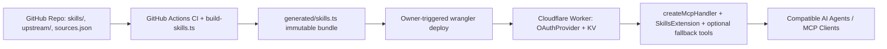

# SPEC-001 — EGAPlugin V1: MCP-First Personal Skill Provider

| Field                   | Value                                                                                            |
| ----------------------- | ------------------------------------------------------------------------------------------------ |
| **Status**              | Revision 6 — MCP-only V1 baseline (owner-approved direction; `V1-001` feasibility gate required) |
| **Revision**            | 6 — supersedes Revision 5 (archived at [SPEC-001-rev5.md](archive/SPEC-001-rev5.md))             |
| **Date**                | 2026-11-26                                                                                       |
| **Target product**      | EGAPlugin V1                                                                                     |
| **Target repository**   | `EGA-BUILDS/EGAPlugin` (public repository — non-sensitive source, specs, and skills only)        |
| **Predecessor**         | `egawilldoit/ega-skills` (preserved untouched)                                                   |
| **Related project**     | EGA Software Factory (independent; untouched)                                                    |
| **Target hosting cost** | `$0/month` (Cloudflare Workers Free)                                                             |

---

## 1. Executive Decision — Why MCP-First Instead of Platform-First

Build a lightweight, authenticated remote **Skills over MCP** server hosted on Cloudflare Workers Free, managed directly through Git and GitHub, rather than building a full web management platform first.

### 1.1 Why the direction changed

The legacy `egawilldoit/ega-skills` platform became expensive to maintain because it rebuilt discovery, resolution, storage, distribution, and versioning from scratch. Revision 5 simplified parts of that design, yet still required a full-stack Next.js application, Vercel hosting, a dynamic release-control plane, GitHub Releases packaging, native plugin bundling, automated upstream sync, a four-area management console, and 12 work packages before delivering a working endpoint.

On November 24, 2026, Anthropic introduced public beta **Skills over MCP** (official extension **SEP-2640**) in Claude and Claude Code, alongside `@modelcontextprotocol/server` v2 Skills support and Cloudflare's stateless `createMcpHandler` adapter. Compatible agents can now discover, inspect, verify, and retrieve skills directly from an MCP server using an open standard.

| Area                       | Revision 5 (Platform-First)               | Revision 6 (MCP-First V1)                        |
| -------------------------- | ----------------------------------------- | ------------------------------------------------ |
| Runtime                    | Next.js full-stack app                    | TypeScript Cloudflare Worker                     |
| Hosting                    | Vercel + Global Config                    | Cloudflare Workers Free (`$0/month` target)      |
| Management UI & API        | 4-area web console + `/api/admin/*`       | Git + GitHub PRs + coding agents                 |
| Release artifact & control | GitHub Releases + external control record | Versioned Worker deployment (`wrangler deploy`)  |
| Upstream updates           | Automated daily sync + merge planner      | Manual Git-based updates with retained baselines |
| Native plugin packaging    | Required in V1                            | Deferred (`.agents/skills/` available locally)   |
| Code Mode                  | Deferred (`EP-011`)                       | Deferred (out of V1)                             |
| Work packages              | 12 (`EP-001` → `EP-012`)                  | 5 (`V1-001` → `V1-005`)                          |

### 1.2 What we are NOT abandoning

The core product requirements remain intact — managed through Git and coding agents in V1 instead of a custom web application:

- Import skills from any compatible external repository without source-specific code.
- Maintain `tracked`, `customized`, and `owned` skills.
- Preserve upstream provenance, licenses, notices, and unmodified baselines.
- Review upstream diffs before accepting changes.
- Explicitly control what is published, with version history and rollback.
- Enforce owner-only authentication, strict content validation, and zero server-side script execution.

### 1.3 Long-term roadmap (proposed, not committed)

- **V1 — MCP Skill Provider (current priority):** Authenticated remote skills on Cloudflare Workers Free, Git-based management, build-time validation, and Wrangler deployment.
- **V2 — Skill lifecycle automation (future, if needed):** Automated upstream watching, update proposals, and helper commands.
- **V3 — Management platform (future, if justified):** Web console, native packaging pipelines, and additional integrations only when real usage proves a genuine limitation.

**Guiding principle:** Build the smallest working skill provider first, use it in real workflows, and expand only when hitting an actual limitation.

---

## 2. Scope, Non-Goals, and Infrastructure Budget

### 2.1 In scope for V1

- One public GitHub repository (`EGA-BUILDS/EGAPlugin`) storing public source code, specifications, non-sensitive Agent Skills folders (`SKILL.md` + supporting text files), `sources.json`, and non-sensitive `upstream/` baselines.
- Build-time validation and bundling (`scripts/build-skills.ts` → `generated/skills.ts`) with strict path, frontmatter, and inventory checks.
- One stateless Cloudflare Worker serving authenticated Skills over MCP (SEP-2640) via `@modelcontextprotocol/server` v2 and `createMcpHandler`.
- Single-Worker `OAuthProvider` with GitHub owner authentication (verified numeric user ID) and one Cloudflare KV namespace, subject to `V1-001` feasibility.
- Up to three lightweight read-only compatibility tools (`search_skills`, `get_skill`, `get_skill_file`), subject to real-client testing in `V1-001`.
- GitHub Actions CI (`ci.yml`) and owner-triggered production deployment (`deploy.yml`) with native Cloudflare rollback and Git release tags.

### 2.2 Explicitly out of scope for V1

Next.js, React, Tailwind CSS, shadcn/ui, Playwright, web management consoles, custom management APIs, application databases, Durable Objects, Vercel, Supabase (unless `V1-001` proves Cloudflare OAuth is infeasible), GitHub Releases artifact servers, automated upstream sync workflows, custom native plugin packagers/installers, Code Mode, MCP Tasks, Elicitation, File Uploads, MCP Apps, multi-user access, and server-side execution of imported scripts.

### 2.3 Target infrastructure inventory

| Resource                                                             | Count | Notes                                                                                     |
| -------------------------------------------------------------------- | ----- | ----------------------------------------------------------------------------------------- |
| Public GitHub repository                                             | 1     | `EGA-BUILDS/EGAPlugin` (non-sensitive content only; secrets in GitHub/Cloudflare Secrets) |
| Cloudflare Worker                                                    | 1     | Serves OAuth + MCP endpoint                                                               |
| GitHub OAuth App                                                     | 1     | Identity only (numeric user ID; no repo scopes)                                           |
| Cloudflare KV namespace                                              | 1     | OAuth grants/tokens only                                                                  |
| Skill databases / Durable Objects / Vercel / Supabase / Web consoles | 0     | None in V1                                                                                |

---

## 3. System Architecture & Repository Layout

### 3.1 Architecture overview



Each MCP request is handled statelessly: the Worker authenticates the request via `OAuthProvider`, constructs a fresh `McpServer` bound to the immutable bundled skill catalog, and serves the response without runtime GitHub API calls or Durable Objects.

### 3.2 Technology stack

| Layer              | Technology                                                                                       |
| ------------------ | ------------------------------------------------------------------------------------------------ |
| Language           | TypeScript (strict mode)                                                                         |
| Runtime            | Cloudflare Workers Free                                                                          |
| MCP server         | `@modelcontextprotocol/server` v2 (exact version pinned in `V1-001`)                             |
| Skills extension   | `io.modelcontextprotocol/skills` — SEP-2640 (Beta schema pinned in `V1-001`)                     |
| Transport          | Cloudflare Agents SDK stateless `createMcpHandler`                                               |
| Authentication     | `workers-oauth-provider` (`OAuthProvider`) + GitHub OAuth + 1 KV namespace (subject to `V1-001`) |
| Content storage    | Git + build-generated `generated/skills.ts`                                                      |
| Build & deployment | Wrangler + GitHub Actions                                                                        |
| Testing            | Vitest + official MCP client SDK (`SkillsClient`)                                                |
| Quality            | ESLint + Prettier + TypeScript `tsc --noEmit`                                                    |
| Package manager    | pnpm (`--frozen-lockfile`)                                                                       |

### 3.3 Target V1 repository structure

```text
EGAPlugin/
├── src/
│   ├── index.ts                # Worker entry point and HTTP routing
│   ├── mcp.ts                  # Official MCP SDK, Skills extension, optional fallback tools
│   └── auth.ts                 # OAuthProvider + GitHub owner ID verification
├── skills/                     # Canonical approved Agent Skills folders (only this enters bundle)
├── upstream/                   # Unmodified accepted upstream baselines (excluded from bundle)
├── generated/
│   └── skills.ts               # Build-generated immutable content bundle (gitignored; regenerated in CI/deploy)
├── scripts/
│   └── build-skills.ts         # Validate skills/ and generate generated/skills.ts
├── tests/
│   ├── catalog.test.ts         # Skill schema, provenance, and bundle validation tests
│   ├── mcp.test.ts             # SEP-2640 conformance, completeness, and fallback tool tests
│   └── auth.test.ts            # OAuth, owner-ID allowlist, and unauthorized access tests
├── docs/
│   └── specs/
│       ├── SPEC-001.md         # Current specification (Revision 6)
│       └── archive/
│           └── SPEC-001-rev5.md
├── .github/
│   └── workflows/
│       ├── ci.yml              # Automated PR/push verification
│       └── deploy.yml          # Owner-triggered production deployment
├── sources.json                # Upstream provenance, mode, commit SHA, license info
├── wrangler.jsonc              # Cloudflare Workers configuration
├── tsconfig.json
├── package.json
├── pnpm-lock.yaml
├── AGENTS.md
└── README.md
```

Only approved files under `skills/` enter `generated/skills.ts` (which is gitignored and regenerated deterministically during local builds, CI, and deployment). Upstream baselines (`upstream/`), documentation, tests, fixtures, `sources.json`, and credentials must never be bundled into the served catalog.

---

## 4. MCP Contract — Official Skills Extension & Compatibility

### 4.1 Primary interface (SEP-2640)

The Worker exposes one authenticated Streamable HTTP MCP endpoint (`/mcp`) implementing the official Skills extension via `@modelcontextprotocol/server/ext/skills`:

| Method                     | Responsibility                                                                                            |
| -------------------------- | --------------------------------------------------------------------------------------------------------- |
| `server/discover`          | Advertise capabilities on modern protocol revisions                                                       |
| `skills/list`              | Return skill names, descriptions, frontmatter, and complete static file manifests (no instruction bodies) |
| `skills/get`               | Exact skill lookup independent of prior listing                                                           |
| `resources/read`           | Retrieve exact authorized file bytes belonging to an approved skill                                       |
| `resources/directory/read` | Optional; advertise only if implemented and verified                                                      |

Start with `SkillsExtension.load(memorySkillFiles(skillFiles), { strict: true })`. If `V1-001` benchmarks show runtime manifest/digest construction approaches Cloudflare's CPU or startup limits, switch to the SDK's supported `SkillSource` adapter backed by build-generated manifests and SHA-256 digests before considering paid hosting.

### 4.2 Exact SDK completeness invariant

Strict mode alone does not guarantee zero silent drops (the SDK can silently skip dot-prefixed files or shadow overlapping resources). CI and `tests/mcp.test.ts` must perform a three-way inventory comparison across:

1. Canonical approved files under `skills/`
2. Build-generated entries in `generated/skills.ts`
3. Actual entries and file manifests exposed by the MCP SDK

All approved paths and raw-byte SHA-256 digests must match across all three inventories:

- **Missing skill files:** must be `0`.
- **Unexpected exposed files:** must be `0`.
- Test `.hidden` files, symlinks, malformed frontmatter, invalid relative paths, and overlapping resource URIs.

### 4.3 Compatibility reader tools (subject to `V1-001` testing)

Because native Skills-over-MCP support is currently public beta in Claude / Claude Code and planned or experimental in Codex, ChatGPT, OpenCode, and Hermes, V1 may include up to three lightweight read-only fallback tools if real-client testing in `V1-001` demonstrates their necessity:

| Tool             | Purpose                                                                  |
| ---------------- | ------------------------------------------------------------------------ |
| `search_skills`  | Lexical name/description filtering returning bounded metadata            |
| `get_skill`      | Retrieve `SKILL.md` instructions and companion file manifest for a skill |
| `get_skill_file` | Retrieve an exact supporting file within the same approved skill         |

Both SEP-2640 and fallback tools must read from the exact same immutable `generated/skills.ts` bundle, enforce identical authentication, and expose the exact same approved skill set. Fallback tools return instruction text to tool-using models and must never be misrepresented as native host skill activation or approval.

### 4.4 Local filesystem compatibility (zero-installer option)

Codex and OpenCode natively discover local filesystem skills under `.agents/skills/` (not an arbitrary repository-root `skills/` directory). If local non-MCP usage is needed in V1, use `.agents/skills/` directly (e.g., via symlink or copy) without building a custom installer or packaging pipeline.

---

## 5. Git-Based Skill Management & Provenance

All skill lifecycle operations in V1 use Git, GitHub pull requests, and coding agents:

| Mode         | Local Edits                                     | Upstream Updates                                               | Required Invariant                                                 |
| ------------ | ----------------------------------------------- | -------------------------------------------------------------- | ------------------------------------------------------------------ |
| `tracked`    | Not permitted without switching to `customized` | Replace with exact reviewed upstream bytes                     | `skills/<id>/` matches `upstream/<id>/` byte-for-byte              |
| `customized` | Allowed via reviewed PR                         | Three-way comparison against `upstream/<id>/` using native Git | Unmodified accepted upstream baseline retained in `upstream/<id>/` |
| `owned`      | Allowed via reviewed PR                         | None                                                           | No external source dependency                                      |

### 5.1 Provenance (`sources.json`)

Every skill under `skills/<id>/` must have a validated entry in `sources.json` recording:

- `id` (lowercase portable Agent Skills folder name, 1–64 chars, matching `SKILL.md` frontmatter `name`)
- `mode` (`tracked`, `customized`, or `owned`)
- For `tracked` / `customized`: `repository`, `path`, exact `commit` SHA, `license`, and preserved license/notice paths.

### 5.2 V1 operations

| Operation             | V1 Workflow                                                                                         |
| --------------------- | --------------------------------------------------------------------------------------------------- |
| Add / Import          | Create `skills/<id>/` (+ `upstream/<id>/` and `sources.json` entry for external skills) on a branch |
| Edit / Customize      | Modify files in Git; update mode if converting `tracked` → `customized`                             |
| Remove                | Delete `skills/<id>/` (and `upstream/<id>/` + `sources.json` entry) in one PR                       |
| Check / Merge updates | Fetch upstream at exact commit SHA, diff against `upstream/<id>/`, merge with native Git            |
| Approve               | Owner reviews PR diff and green CI, then merges to `main`                                           |
| Publish               | Owner triggers `deploy.yml` for the exact approved `main` commit SHA                                |

---

## 6. Authentication & Security

### 6.1 Authentication design (verified in `V1-001`)

Use Cloudflare's official `workers-oauth-provider` (`OAuthProvider`) to run both the OAuth authorization server and the MCP resource server in **one Worker**:

- **Upstream identity:** GitHub OAuth login verifying the owner's exact numeric GitHub user ID (`GITHUB_OWNER_ID`). Reject every other GitHub account.
- **Zero repo scopes:** Request only basic identity (`read:user` or minimal identity scope); never request GitHub repository read/write scopes.
- **Token storage:** One Cloudflare KV namespace for OAuth grants and tokens.
- **Eventual consistency disclosure:** Cloudflare KV is eventually consistent; token revocation may not propagate instantaneously across all edge locations. `V1-001` must measure observed revocation propagation rather than claiming instant revocation.
- **Protocol compliance & explicit handler enforcement:** Serve OAuth protected-resource metadata (`/.well-known/oauth-protected-resource`) and enforce PKCE/consent. Because `OAuthProvider.requiredScopes` does not automatically enforce application-specific authorization, our MCP handler must independently verify the authorized numeric GitHub owner ID, required read scope, token resource/audience binding, and valid authorization context on every protected MCP call.

### 6.2 Mandatory security controls

1. **Public repository hygiene (explicit trust boundary):** `EGA-BUILDS/EGAPlugin` is intentionally **public**. Store only public source code, specifications, and non-sensitive skills in Git. Never commit confidential skills, credentials, tokens, or personal information — including inside `upstream/` snapshots or `sources.json`. Store all private credentials strictly in Cloudflare Secrets and GitHub Actions Secrets. **OAuth protects the MCP endpoint, not content published on GitHub.**
2. **Owner-only access:** Every protected MCP method (`skills/list`, `skills/get`, `resources/read`, fallback tools) requires a valid owner-authorized token. Unauthenticated requests return proper OAuth challenges without leaking catalog metadata.
3. **No mutation secrets in runtime:** The Worker runtime never holds GitHub write tokens or Cloudflare deploy tokens.
4. **No server-side script execution:** Imported scripts or hooks are never executed in CI or the Worker; V1 served skills are text-only.
5. **No sensitive logging:** Never log OAuth tokens, client secrets, or full skill bodies in production logs.
6. **No unauthenticated preview or version URLs:** Set `"preview_urls": false` in `wrangler.jsonc` and verify historical Version URLs (`<version-id>-ega-plugin...workers.dev`) are disabled or enforce identical OAuth protection.
7. **Strict input and content validation:** Reject path traversal, symlinks, malformed YAML, oversized files, invalid UTF-8, and unmanifested paths at build time and request time.

---

## 7. Deployment, Configuration, and Rollback

### 7.1 Minimal `wrangler.jsonc`

```jsonc
{
  "$schema": "node_modules/wrangler/config-schema.json",
  "name": "ega-plugin",
  "main": "src/index.ts",
  "compatibility_date": "2026-11-26",
  "workers_dev": true,
  "preview_urls": false,
}
```

Additional compatibility flags and the OAuth KV binding will be added only after `V1-001` confirms them. Proposed production endpoint (not yet provisioned): `https://ega-plugin.<account-subdomain>.workers.dev/mcp`. No custom domain is required.

### 7.2 CI & manual deployment

- **CI (`ci.yml`) on PRs and pushes to `main`:**
  ```bash
  pnpm install --frozen-lockfile
  pnpm lint
  pnpm format:check
  pnpm typecheck
  pnpm test
  pnpm exec wrangler deploy --dry-run
  ```
  _(Add `pnpm build:skills` once `scripts/build-skills.ts` is implemented in `V1-003`.)_
- **Production deployment (`deploy.yml`):** Manually triggered (`workflow_dispatch`) by the owner for an exact approved `main` commit SHA. Uses a narrowly scoped Cloudflare API token stored in GitHub Actions secrets and account ID in Actions variables. Verify which branch protection and deployment approval controls are enabled on the public GitHub repository (do not assume a manual workflow alone is an independent security boundary). Never auto-deploy unreviewed upstream changes.

### 7.3 Rollback & emergency withdrawal

- **Fast rollback:** `pnpm exec wrangler rollback <VERSION_ID>`.
- **Long-term reproducibility:** Tag every production deployment in Git (`v1.x.y`) so any prior release can be rebuilt even after Cloudflare prunes older deployment versions.
- **Emergency withdrawal:** Deploy a deny-all Worker version (or disable all active endpoints including historical Version URLs). Note that disabling `workers.dev` alone may not disable historical Version URLs, and skills already cached by a client cannot be remotely recalled.

---

## 8. Performance, Platform Limits, and Cost

### 8.1 Verified Cloudflare Workers Free limits

| Limit                             | Cloudflare Workers Free |
| --------------------------------- | ----------------------- |
| Worker bundle size (uncompressed) | 64 MiB                  |
| Worker bundle size (compressed)   | None                    |
| CPU time per invocation           | 10 ms                   |
| Global-scope startup time         | 1 second                |
| Daily requests                    | 100,000 / day           |

_Note: Enforce a conservative internal bundle budget in `scripts/build-skills.ts` (e.g., text-only skills, max file size 256 KiB, max bundle size explicitly capped) so CPU and memory stay predictable._

### 8.2 Benchmark matrix & proposed acceptance targets

`V1-001` must benchmark authenticated cold and warm requests (SDK init, `skills/list`, `skills/get`, `resources/read`, and fallback tools) across four catalog sizes:

| Scenario | Catalog Size          |
| -------- | --------------------- |
| Minimal  | 1 skill               |
| Small    | 10 skills             |
| Expected | 50 skills, 300 files  |
| Stress   | 100 skills, 600 files |

| Metric                      | Proposed Target                    |
| --------------------------- | ---------------------------------- |
| p95 CPU time                | `<= 5 ms`                          |
| CPU limit errors            | `0` during acceptance tests        |
| Global startup              | Within Cloudflare's 1-second limit |
| Missing skill files         | `0`                                |
| Unexpected exposed files    | `0`                                |
| Unauthorized content access | `0`                                |

If runtime `SkillsExtension.load` exceeds targets on 50–100 skills, evaluate the SDK's `SkillSource` adapter with build-generated manifests/digests before considering a paid Workers plan.

### 8.3 Target cost

| Service                                  | Expected Monthly Cost   |
| ---------------------------------------- | ----------------------- |
| GitHub public repository & Actions       | `$0` (within allowance) |
| Cloudflare Workers Free & 1 KV namespace | `$0` (within allowance) |
| GitHub OAuth App                         | `$0`                    |
| Vercel / Supabase / Custom domain        | Not used (`$0`)         |
| **Total target**                         | **`$0/month`**          |

---

## 9. Implementation Roadmap (5 Work Packages)

Work sequentially (`V1-001` → `V1-005`). Do not start `V1-002` until `V1-001` proves SDK compatibility, OAuth, and CPU feasibility and receives owner sign-off.

| ID         | Deliverable                                                                 | Depends On | Exit Gate / Acceptance Criteria                                                                                                                                                                                                                                                                                                                                                                                                                                                                                                                                                                                                                                                                                                                                                                |
| ---------- | --------------------------------------------------------------------------- | ---------- | ---------------------------------------------------------------------------------------------------------------------------------------------------------------------------------------------------------------------------------------------------------------------------------------------------------------------------------------------------------------------------------------------------------------------------------------------------------------------------------------------------------------------------------------------------------------------------------------------------------------------------------------------------------------------------------------------------------------------------------------------------------------------------------------------- |
| **V1-001** | **Feasibility:** SDK, OAuth, client compatibility & CPU benchmarks          | —          | Using an owner-authorized disposable non-production spike Worker (synthetic skills + separate test credentials, no production deployment): **G1** exact SDK/Cloudflare account/quota verified, plus `@cloudflare/vitest-plugin` (`workerd`) tests and `wrangler types` adopted; **G2** `SkillsClient` discovery/retrieval passes; **G3** single-Worker `OAuthProvider` + GitHub owner ID + explicit handler scope/resource checks + KV handshake verified; **G4** Claude native skills & fallback tool necessity recorded; **G5** 1/10/50/100-skill cold/warm CPU benchmarks pass targets (or `SkillSource` fallback validated); **G6** KV revocation latency, private caching & historical version-URL protection measured; **G7** smallest proven design and unresolved blockers documented. |
| **V1-002** | **Minimal Skills MCP server:** Standard SEP-2640 + needed fallback tools    | `V1-001`   | Serves fixture skill(s) and supporting files from an immutable in-memory bundle via `createMcpHandler`; `SkillsClient` conformance tests pass; exact SDK completeness test confirms 0 missing and 0 extra exposed files; fallback tools (if proven needed in `V1-001`) share the exact same bundle.                                                                                                                                                                                                                                                                                                                                                                                                                                                                                            |
| **V1-003** | **Skill management foundation:** Git lifecycle, provenance & bundle builder | `V1-002`   | `skills/`, `upstream/`, `sources.json`, and `scripts/build-skills.ts` → `generated/skills.ts` implemented; validates Agent Skills naming/frontmatter, safe relative paths, text-only bounds, `tracked`/`customized`/`owned` invariants, and license preservation; excludes `upstream/` and non-skill files from bundle.                                                                                                                                                                                                                                                                                                                                                                                                                                                                        |
| **V1-004** | **Production security, deployment & rollback:** Auth hardening & CI/CD      | `V1-003`   | Single-Worker `OAuthProvider` with GitHub numeric user ID allowlist enforced on all MCP routes; negative auth tests (unauthenticated, wrong GitHub user, wrong audience/scope, expired token) pass; `preview_urls: false` and historical version URL protection verified; manual `deploy.yml`, Git tagging, `wrangler rollback`, and emergency withdrawal documented and tested.                                                                                                                                                                                                                                                                                                                                                                                                               |
| **V1-005** | **E2E acceptance & V1 release:** Real-client proof & production cutover     | `V1-004`   | Public-repo hygiene verified (no confidential skills, personal info, or secrets in Git/upstream snapshots); real-client discovery, approval, file retrieval, update, and fallback behavior verified with recorded client versions; free-tier CPU/latency verified on production deployment; rollback rehearsed; V1 tagged and released.                                                                                                                                                                                                                                                                                                                                                                                                                                                        |

---

## 10. Relationship to Legacy EGA Skills & EGA Software Factory

- **`egawilldoit/ega-skills`:** Preserved untouched until V1 proves itself in daily use and the owner explicitly authorizes retirement or selective skill import.
- **EGA Software Factory:** Independent project with its own Worker and releases. Its deployment configuration may be read as an implementation reference, but no code, runtime, or configuration changes are authorized by this specification.

---

## 11. Official Documentation References

- **Skills over MCP announcement:** https://claude.com/resources/articles/skills-over-mcp-tasks-and-more
- **Agent Skills specification:** https://agentskills.io/specification
- **Official MCP Skills Extension (Beta):** https://skills.extensions.modelcontextprotocol.io/specification/beta/skills
- **Official TypeScript SDK Skills implementation guide:** https://github.com/modelcontextprotocol/typescript-sdk/tree/main/skills/mcp-typescript-sdk-skills
- **MCP Skills Extension implementation tracker:** https://github.com/modelcontextprotocol/ext-skills/blob/main/docs/implementations.md
- **Cloudflare Remote MCP Server guide:** https://developers.cloudflare.com/agents/guides/remote-mcp-server/
- **Cloudflare MCP Authorization:** https://developers.cloudflare.com/agents/model-context-protocol/protocol/authorization/
- **Cloudflare Workers OAuth Provider:** https://github.com/cloudflare/workers-oauth-provider
- **GitHub OAuth Apps flow:** https://docs.github.com/en/apps/oauth-apps/building-oauth-apps/authorizing-oauth-apps
- **Cloudflare Workers platform limits:** https://developers.cloudflare.com/workers/platform/limits/
- **Cloudflare Worker size limit update (Sept 2026):** https://developers.cloudflare.com/changelog/post/2026-09-04-increased-worker-size-limit/
- **Cloudflare Workers TypeScript (`wrangler types`):** https://developers.cloudflare.com/workers/languages/typescript/
- **Cloudflare Workers Vitest integration:** https://developers.cloudflare.com/workers/testing/vitest-integration/
- **Cloudflare Workers versions & deployments:** https://developers.cloudflare.com/workers/versions-and-deployments/
- **Cloudflare Workers preview & version URLs:** https://developers.cloudflare.com/workers/configuration/previews/
- **Cloudflare KV consistency:** https://developers.cloudflare.com/kv/concepts/how-kv-works/
- **Codex skills discovery:** https://developers.openai.com/codex/skills
- **OpenCode skills discovery:** https://opencode.ai/docs/skills/
