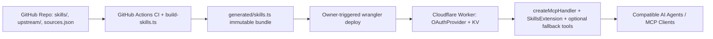

# SPEC-001 — EGAPlugin V1: MCP-First Personal Skill Provider

| Field                   | Value                                                                                       |
| ----------------------- | ------------------------------------------------------------------------------------------- |
| **Status**              | Revision 7 takes effect on explicit owner adoption and merge of the feasibility PR. See §9. |
| **Revision**            | 7 — supersedes Revision 6 (preserved in tag `v0.0.1`)                                       |
| **Date**                | 2026-11-27                                                                                  |
| **Target product**      | EGAPlugin V1                                                                                |
| **Target repository**   | `EGA-BUILDS/EGAPlugin` (public repository — non-sensitive source, specs, and skills only)   |
| **Predecessor**         | `egawilldoit/ega-skills` (preserved untouched)                                              |
| **Related project**     | EGA Software Factory (independent; untouched)                                               |
| **Target hosting cost** | `$0/month` (Cloudflare Workers Free)                                                        |

---

## 1. Executive Decision — Why MCP-First Instead of Platform-First

Build a lightweight, authenticated remote **Skills over MCP** server hosted on Cloudflare Workers Free, managed directly through Git and GitHub, rather than building a full web management platform first.

### 1.1 Why the direction changed

The legacy `egawilldoit/ega-skills` platform became expensive to maintain because it rebuilt discovery, resolution, storage, distribution, and versioning from scratch. Revision 5 simplified parts of that design, yet still required a full-stack Next.js application, Vercel hosting, a dynamic release-control plane, GitHub Releases packaging, native plugin bundling, automated upstream sync, a four-area management console, and 12 work packages before delivering a working endpoint.

Anthropic announced public beta Skills over MCP for Claude and Claude Code on November 24, 2026. SEP-2640 defines the protocol for discovering and retrieving skills. The official TypeScript SDK v2 implements the extension and provides a native fetch handler for Workers. EGAPlugin client compatibility requires the acceptance evidence in §12. [Anthropic announcement](https://claude.com/resources/articles/skills-over-mcp-tasks-and-more)

| Area                       | Revision 5 (Platform-First)               | Revision 6 (MCP-First V1)                        |
| -------------------------- | ----------------------------------------- | ------------------------------------------------ |
| Runtime                    | Next.js full-stack app                    | TypeScript Cloudflare Worker                     |
| Hosting                    | Vercel + Global Config                    | Cloudflare Workers Free (`$0/month` target)      |
| Management UI & API        | 4-area web console + `/api/admin/*`       | Git + GitHub PRs + coding agents                 |
| Release artifact & control | GitHub Releases + external control record | Versioned Worker deployment (`wrangler deploy`)  |
| Upstream updates           | Automated daily sync + merge planner      | Manual Git-based updates with retained baselines |
| Native plugin packaging    | Required in V1                            | Deferred (`.agents/skills/` available locally)   |
| Code Mode                  | Deferred (`EP-011`)                       | Deferred (out of V1)                             |
| Work packages              | 12 (`EP-001` → `EP-012`)                  | 5 (`V1-001` → `V1-005`)                          |

### 1.2 What we are NOT abandoning

The core product requirements remain intact — managed through Git and coding agents in V1 instead of a custom web application:

- Import skills from any compatible external repository without source-specific code.
- Maintain `tracked`, `customized`, and `owned` skills.
- Preserve upstream provenance, licenses, notices, and unmodified baselines.
- Review upstream diffs before accepting changes.
- Explicitly control what is published, with version history and rollback.
- Enforce owner-only authentication, strict content validation, and zero server-side script execution.

### 1.3 Long-term roadmap (proposed, not committed)

- **V1 — MCP Skill Provider (current priority):** Authenticated remote skills on Cloudflare Workers Free, Git-based management, build-time validation, and Wrangler deployment.
- **V2 — Skill lifecycle automation (future, if needed):** Automated upstream watching, update proposals, and helper commands.
- **V3 — Management platform (future, if justified):** Web console, native packaging pipelines, and additional integrations only when real usage proves a genuine limitation.

**Guiding principle:** Build the smallest working skill provider first, use it in real workflows, and expand only when hitting an actual limitation.

---

## 2. Scope, Non-Goals, and Infrastructure Budget

### 2.1 In scope for V1

- One public GitHub repository (`EGA-BUILDS/EGAPlugin`) storing public source code, specifications, non-sensitive Agent Skills folders (`SKILL.md` + supporting text files), `sources.json`, and non-sensitive `upstream/` baselines.
- Build-time validation and bundling (`scripts/build-skills.ts` → `generated/skills.ts`) with strict path, frontmatter, and inventory checks.
- One stateless Cloudflare Worker serving authenticated Skills over MCP (SEP-2640) via `@modelcontextprotocol/server` v2 and `createMcpHandler`.
- Single-Worker `OAuthProvider` with GitHub owner authentication (verified numeric user ID) and one Cloudflare KV namespace, subject to live production acceptance in `V1-004`.
- Up to three lightweight read-only compatibility tools (`search_skills`, `get_skill`, `get_skill_file`), when justified by observed client behavior under §4.2. Exhaustive acceptance is due in `V1-005`.
- GitHub Actions CI (`ci.yml`) and owner-triggered production deployment (`deploy.yml`) with native Cloudflare rollback and Git release tags.

### 2.2 Explicitly out of scope for V1

Next.js, React, Tailwind CSS, shadcn/ui, Playwright, web management consoles, custom management APIs, application databases, Durable Objects, Vercel, Supabase, GitHub Releases artifact servers, automated upstream sync workflows, custom native plugin packagers/installers, Code Mode, MCP Tasks, Elicitation, File Uploads, MCP Apps, multi-user access, and server-side execution of imported scripts.

### 2.3 Target infrastructure inventory

| Resource                                                             | Count | Notes                                                                                     |
| -------------------------------------------------------------------- | ----- | ----------------------------------------------------------------------------------------- |
| Public GitHub repository                                             | 1     | `EGA-BUILDS/EGAPlugin` (non-sensitive content only; secrets in GitHub/Cloudflare Secrets) |
| Cloudflare Worker                                                    | 1     | Serves OAuth + MCP endpoint                                                               |
| GitHub OAuth App                                                     | 1     | Identity only (numeric user ID; no repo scopes)                                           |
| Cloudflare KV namespace                                              | 1     | OAuth grants/tokens only                                                                  |
| Skill databases / Durable Objects / Vercel / Supabase / Web consoles | 0     | None in V1                                                                                |

---

## 3. System Architecture & Repository Layout

### 3.1 Architecture overview



Each MCP request is handled statelessly: the Worker authenticates the request via `OAuthProvider`, constructs a fresh `McpServer` bound to the immutable bundled skill catalog, and serves the response without runtime GitHub API calls or Durable Objects.

### 3.2 Technology stack

| Layer              | Technology                                                                                                          |
| ------------------ | ------------------------------------------------------------------------------------------------------------------- |
| Language           | TypeScript (strict mode)                                                                                            |
| Runtime            | Cloudflare Workers Free                                                                                             |
| MCP server         | `@modelcontextprotocol/server` v2 (local research used `2.4.0`, see §11)                                            |
| Skills extension   | `io.modelcontextprotocol/skills`, SEP-2640 beta (see §11)                                                           |
| Transport          | Native SDK v2 `createMcpHandler` (stateless Streamable HTTP)                                                        |
| Authentication     | `workers-oauth-provider` (`OAuthProvider`) + GitHub OAuth + 1 KV namespace (live production acceptance in `V1-004`) |
| Content storage    | Git + build-generated `generated/skills.ts`                                                                         |
| Build & deployment | Wrangler + GitHub Actions                                                                                           |
| Testing            | Vitest, official Cloudflare Vitest integration, and `@modelcontextprotocol/client` v2                               |
| Quality            | ESLint + Prettier + TypeScript `tsc --noEmit`                                                                       |
| Package manager    | pnpm (`--frozen-lockfile`)                                                                                          |

### 3.3 Target V1 repository structure

```text
EGAPlugin/
├── src/
│   ├── index.ts                # Worker entry point and HTTP routing
│   ├── mcp.ts                  # Official MCP SDK, Skills extension, optional fallback tools
│   └── auth.ts                 # OAuthProvider + GitHub owner ID verification
├── skills/                     # Canonical approved Agent Skills folders (only this enters bundle)
├── upstream/                   # Unmodified accepted upstream baselines (excluded from bundle)
├── generated/
│   └── skills.ts               # Build-generated immutable content bundle (gitignored; regenerated in CI/deploy)
├── scripts/
│   └── build-skills.ts         # Validate skills/ and generate generated/skills.ts
├── tests/
│   ├── catalog.test.ts         # Skill schema, provenance, and bundle validation tests
│   ├── mcp.test.ts             # SDK protocol, catalog integrity, and fallback tool tests
│   └── auth.test.ts            # OAuth, owner-ID allowlist, and unauthorized access tests
├── docs/
│   └── specs/
│       ├── SPEC-001.md         # Current specification (Revision 7)
│       └── archive/
│           └── SPEC-001-rev5.md
├── .github/
│   └── workflows/
│       ├── ci.yml              # Automated PR/push verification
│       └── deploy.yml          # Owner-triggered production deployment
├── sources.json                # Upstream provenance, mode, commit SHA, license info
├── wrangler.jsonc              # Cloudflare Workers configuration
├── tsconfig.json
├── package.json
├── pnpm-lock.yaml
├── AGENTS.md
└── README.md
```

Only approved files under `skills/` enter `generated/skills.ts` (which is gitignored and regenerated deterministically during local builds, CI, and deployment). Upstream baselines (`upstream/`), documentation, tests, fixtures, `sources.json`, and credentials must never be bundled into the served catalog.

---

## 4. MCP Contract — Official Skills Extension & Compatibility

### 4.1 MCP SDK v2 compliance

- Use `@modelcontextprotocol/server` v2 for the server and `@modelcontextprotocol/client` v2 for automated protocol tests. Pin the exact releases. Use supported public APIs and verify exports, types, and behavior against the pinned release before implementation. Read the applicable official v2 guides and coding-agent skills in §11.
- Use native `createMcpHandler` with a factory that creates a fresh `McpServer` for every MCP request. Serve one authenticated Streamable HTTP endpoint at `/mcp`.
- Use the official SEP-2640 `SkillsExtension` from `@modelcontextprotocol/server/ext/skills`. Enable only implemented, verified capabilities. Declaring Skills requires the Resources capability. Enable optional directory reads only after verifying them.
- Support `2026-07-28` through the SDK's modern stateless request envelope and `server/discover`. Use SDK-native protocol negotiation and stateless legacy compatibility for supported 2025-era clients, including their `initialize` flow. Verify exact legacy revisions and features against the pinned SDK and record the tested matrix. SDK legacy interoperability gives no evidence of native Skills support in a particular host.
- Serve a build-generated immutable `SkillSource` backed by the single canonical catalog under `skills/`. Prefer the SDK's public `skillEntry` helper during generation. Apply the local integrity checks in §12 for v0.1.0 and complete live cold and warm validation for v0.3.0.
- Generate static, complete manifests for every approved skill, including `SKILL.md` and each approved supporting file exactly once. Record each resource URI, raw-byte size and SHA-256 digest as `sha256:<lowercase-hex>`. Serve the exact approved content without normalization or substitutions. Keep the generated catalog and response observations in exact agreement under §12.

Prohibited in V1 are MCP SDK v1 and its implementation patterns, the Cloudflare `agents` MCP wrapper, custom JSON-RPC, custom protocol negotiation or session management, duplicate implementations of SEP-2640, runtime catalog reconstruction as the default design, duplicate catalogs, unnecessary framework layers, and unverified capability declarations.

### 4.2 Discovery, pagination, and compatibility tools

| Method                     | Responsibility                                                                                    |
| -------------------------- | ------------------------------------------------------------------------------------------------- |
| `server/discover`          | Advertise implemented and verified capabilities to modern clients                                 |
| `skills/list`              | Enumerate approved skill entries with metadata and complete static manifests, without file bodies |
| `skills/get`               | Look up an approved skill by its exact `SKILL.md` URI, even without a prior listing               |
| `resources/read`           | Return the exact authorized bytes for one approved resource URI                                   |
| `resources/directory/read` | Optional paginated direct-child listing, enabled only if implemented and verified                 |

Document and test server-enforced upper bounds for listing page size, response size, and accepted input size. Iterate the immutable catalog in deterministic order with opaque cursors. Keep each skill entry and its manifest intact on one page. Return `nextCursor` only when another page exists, and reject malformed cursors. Direct lookup and authorized resource reads must work without a listing cursor. Test the limits with the benchmark catalog sizes in §8.

Add up to three read-only compatibility tools where observed client workflows demonstrate a need. Verify authorization and catalog parity locally for v0.1.0.

| Tool             | Purpose                                                           |
| ---------------- | ----------------------------------------------------------------- |
| `search_skills`  | Bounded lexical name and description search, returning metadata   |
| `get_skill`      | Retrieve `SKILL.md` instructions and the complete static manifest |
| `get_skill_file` | Retrieve one exact supporting file within the approved skill      |

Native Skills and compatibility tools must share the same generated catalog, exact bytes, and authorization checks. Apply the same content and input limits. Treat tool output as ordinary content. The host's native skill-loading path is the only path that activates a skill.

### 4.3 HTTP privacy and MCP freshness

Send `Cache-Control: private, no-store` on protected MCP responses, including errors and authorization challenges, and on OAuth responses that carry credentials or user-specific data. Keep these responses out of shared caches and the Workers Cache API.

On `2026-07-28`, use the SDK's conservative defaults of `cacheScope: "private"` and `ttlMs: 0` for cacheable results, including discovery, applicable lists, `skills/get`, `resources/read`, and optional directory reads. Use the pinned SDK's public cache hint APIs where an explicit setting is needed. Private scope binds reuse to the authorization context, and zero TTL gives the response no freshness window. Legacy responses omit these modern fields and retain the same HTTP privacy policy. Freshness metadata governs response reuse. The held manifest governs integrity and approval.

### 4.4 Host verification, approval, and execution

The Worker authenticates, authorizes and serves approved bytes. It delegates native activation, user approval and execution policy to the host and never executes imported scripts, hooks or skill instructions.

- Identify a skill by host-assigned server identity and skill URI. Hosts must preserve origin in model context, treat content as untrusted, and prevent remote skills from silently shadowing local skills or skills from another server.
- A host fetches `SKILL.md` when loading and supporting files when needed. Verify the file size and SHA-256 against the held manifest on each read, subject to the extension's verified-cache rules. Verify that parsed `SKILL.md` frontmatter matches the advertised entry before activation. Keep reads within the held manifest and origin, with separate explicit per-call user approval for any cross-origin read.
- On a missing manifest entry or verification failure, reject the content and refresh the metadata via `skills/get` or `skills/list`. Digests establish consistency with the entry. Trust and permission still come from host policy.
- The host applies its user approval policy before activation. Persisted per-skill approval must bind to the complete URI and digest set, and any change to that set revokes approval and requires a fresh prompt before loading or executing. Nested activation requires separate explicit consent.
- Serving a resource or tool result grants no local execution or permissions. The host requires explicit per-skill user approval for host code execution, including hooks and commands prompted by skill text, and separately approval-gates permission expansion such as `allowed-tools`. If the host stores verified remote bytes on disk, preserve their origin and keep the cache outside local skill discovery paths.

### 4.5 Local filesystem compatibility

If a target client needs filesystem skills, verify its supported discovery path before using it. For clients that support `.agents/skills/`, use that path directly for a separate, deliberate local workflow. Remote cache content must never be promoted automatically to a filesystem skill.

---

## 5. Git-Based Skill Management & Provenance

All skill lifecycle operations in V1 use Git, GitHub pull requests, and coding agents:

| Mode         | Local Edits                                     | Upstream Updates                                               | Required Invariant                                                 |
| ------------ | ----------------------------------------------- | -------------------------------------------------------------- | ------------------------------------------------------------------ |
| `tracked`    | Not permitted without switching to `customized` | Replace with exact reviewed upstream bytes                     | `skills/<id>/` matches `upstream/<id>/` byte-for-byte              |
| `customized` | Allowed via reviewed PR                         | Three-way comparison against `upstream/<id>/` using native Git | Unmodified accepted upstream baseline retained in `upstream/<id>/` |
| `owned`      | Allowed via reviewed PR                         | None                                                           | No external source dependency                                      |

### 5.1 Provenance (`sources.json`)

Every skill under `skills/<id>/` must have a validated entry in `sources.json` recording:

- `id` (lowercase portable Agent Skills folder name, 1–64 chars, matching `SKILL.md` frontmatter `name`)
- `mode` (`tracked`, `customized`, or `owned`)
- For `tracked` / `customized`: `repository`, `path`, exact `commit` SHA, `license`, and preserved license/notice paths.

### 5.2 V1 operations

| Operation             | V1 Workflow                                                                                         |
| --------------------- | --------------------------------------------------------------------------------------------------- |
| Add / Import          | Create `skills/<id>/` (+ `upstream/<id>/` and `sources.json` entry for external skills) on a branch |
| Edit / Customize      | Modify files in Git; update mode if converting `tracked` → `customized`                             |
| Remove                | Delete `skills/<id>/` (and `upstream/<id>/` + `sources.json` entry) in one PR                       |
| Check / Merge updates | Fetch upstream at exact commit SHA, diff against `upstream/<id>/`, merge with native Git            |
| Approve               | Owner reviews PR diff and green CI, then merges to `main`                                           |
| Publish               | Owner triggers `deploy.yml` for the exact approved `main` commit SHA                                |

---

## 6. Authentication & Security

### 6.1 Proposed authentication design

Use Cloudflare's official `workers-oauth-provider` (`OAuthProvider`) to run both the OAuth authorization server and the MCP resource server in **one Worker**:

- **Upstream identity:** GitHub OAuth login verifying the owner's exact numeric GitHub user ID (`GITHUB_OWNER_ID`). Reject every other GitHub account.
- **Zero repo scopes:** Request only basic identity (`read:user` or minimal identity scope); never request GitHub repository read/write scopes.
- **Token storage:** One Cloudflare KV namespace for OAuth grants and tokens.
- **Eventual consistency disclosure:** Cloudflare KV is eventually consistent; token revocation may not propagate instantaneously across all edge locations. Measure observed propagation for v0.3.0 and document the consistency window.
- **Protocol compliance & explicit handler enforcement:** Serve path-scoped OAuth protected-resource metadata for `/mcp` (`/.well-known/oauth-protected-resource/mcp`) and enforce PKCE/consent. Because `OAuthProvider.requiredScopes` does not automatically enforce application-specific authorization, our MCP handler must independently verify the authorized numeric GitHub owner ID, required read scope, token resource/audience binding, and valid authorization context on every protected MCP call.

### 6.2 Mandatory security controls

1. **Public repository hygiene (explicit trust boundary):** `EGA-BUILDS/EGAPlugin` is intentionally **public**. Store only public source code, specifications, and non-sensitive skills in Git. Never commit confidential skills, credentials, tokens, or personal information — including inside `upstream/` snapshots or `sources.json`. Use Cloudflare Secrets for Worker runtime secrets and GitHub Actions Secrets for CI secrets. On the authorized operations host, agents may reuse the owner-approved Cloudflare API token and GitHub OAuth application credentials from `~/egaplugin/.env` for approved EGAPlugin operations without separate credential consent. Keep this file outside all repositories with mode `0600` and its directory with mode `0700`. Keep credentials out of logs and artifacts. Existing approval requirements apply to the operations themselves. **OAuth protects the MCP endpoint, not content published on GitHub.**
2. **Owner-only access:** Every protected MCP method (`skills/list`, `skills/get`, `resources/read`, fallback tools) requires a valid owner-authorized token. Unauthenticated requests return proper OAuth challenges without leaking catalog metadata.
3. **No mutation secrets in runtime:** The Worker runtime never holds GitHub write tokens or Cloudflare deploy tokens.
4. **No server-side script execution:** Never execute untrusted upstream scripts or hooks in local, CI, or Worker runtimes. V1 serves approved text files only.
5. **No sensitive logging:** Never log OAuth tokens, client secrets, or full skill bodies in production logs.
6. **No unauthenticated preview or version URLs:** Set `"preview_urls": false` in `wrangler.jsonc` and verify historical Version URLs (`<version-id>-ega-plugin...workers.dev`) are disabled or enforce identical OAuth protection.
7. **Strict input and content validation:** Reject path traversal, symlinks, malformed YAML, oversized files, invalid UTF-8, and unmanifested paths at build time and request time.
8. **Streamable HTTP Origin validation:** Check every incoming `/mcp` request for an `Origin` header before it can reach either SDK protocol handler. Validate any supplied Origin against the explicitly allowed origins and return HTTP `403 Forbidden` for malformed or disallowed values. Requests without an Origin remain subject to the same authentication and authorization checks.

---

## 7. Deployment, Configuration, and Rollback

### 7.1 Minimal `wrangler.jsonc`

```jsonc
{
  "$schema": "node_modules/wrangler/config-schema.json",
  "name": "ega-plugin",
  "main": "src/index.ts",
  "compatibility_date": "2026-11-26",
  "workers_dev": true,
  "preview_urls": false,
}
```

Use only compatibility flags verified for the pinned Worker dependencies. Provision the live OAuth KV binding during authorized `V1-004` production acceptance. The v0.1.0 Worker must fail closed when production authorization is unavailable. Proposed production endpoint (not yet provisioned): `https://ega-plugin.<account-subdomain>.workers.dev/mcp`. No custom domain is required.

### 7.2 CI & manual deployment

- **CI (`ci.yml`) on PRs and pushes to `main`:**
  ```bash
  pnpm install --frozen-lockfile
  pnpm lint
  pnpm format:check
  pnpm typecheck
  pnpm test
  pnpm exec wrangler deploy --dry-run
  ```
  _(Add `pnpm build:skills` once `scripts/build-skills.ts` is implemented in `V1-003`.)_
- **Production deployment (`deploy.yml`):** Manually triggered (`workflow_dispatch`) by the owner for an exact approved `main` commit SHA. Uses a narrowly scoped Cloudflare API token stored in GitHub Actions secrets and account ID in Actions variables. Verify which branch protection and deployment approval controls are enabled on the public GitHub repository (do not assume a manual workflow alone is an independent security boundary). Never auto-deploy unreviewed upstream changes.

### 7.3 Rollback & emergency withdrawal

- **Fast rollback:** `pnpm exec wrangler rollback <VERSION_ID>`.
- **Long-term reproducibility:** Tag every production deployment in Git (`v1.x.y`) so any prior release can be rebuilt even after Cloudflare prunes older deployment versions.
- **Emergency withdrawal:** Deploy a deny-all Worker version (or disable all active endpoints including historical Version URLs). Note that disabling `workers.dev` alone may not disable historical Version URLs, and skills already cached by a client cannot be remotely recalled.

---

## 8. Performance, Platform Limits, and Cost

### 8.1 Verified Cloudflare Workers Free limits

| Limit                             | Cloudflare Workers Free |
| --------------------------------- | ----------------------- |
| Worker bundle size (uncompressed) | 64 MiB                  |
| Worker bundle size (compressed)   | None                    |
| CPU time per invocation           | 10 ms                   |
| Global-scope startup time         | 1 second                |
| Daily requests                    | 100,000 / day           |

_Note: Enforce a conservative internal bundle budget in `scripts/build-skills.ts` (e.g., text-only skills, max file size 256 KiB, max bundle size explicitly capped) so CPU and memory stay predictable._

### 8.2 Benchmark matrix & proposed acceptance targets

For v0.3.0, benchmark authenticated cold and warm requests (SDK init, `skills/list`, `skills/get`, and `resources/read`) across four catalog sizes. Include fallback tool calls when those tools are enabled in the build under test.

| Scenario | Catalog Size          |
| -------- | --------------------- |
| Minimal  | 1 skill               |
| Small    | 10 skills             |
| Expected | 50 skills, 300 files  |
| Stress   | 100 skills, 600 files |

| Metric                      | Proposed Target                    |
| --------------------------- | ---------------------------------- |
| p95 CPU time                | `<= 5 ms`                          |
| CPU limit errors            | `0` during acceptance tests        |
| Global startup              | Within Cloudflare's 1-second limit |
| Missing skill files         | `0`                                |
| Unexpected exposed files    | `0`                                |
| Unauthorized content access | `0`                                |

Local `workerd` catalog timing favored the build-generated `SkillSource`. The [feasibility report](../feasibility/V1-001-report.md) preserves those elapsed-time measurements and the warm authenticated local HTTP timings. Report these separately from live Cloudflare per-request CPU time, global-scope startup duration, and end-to-end authenticated request latency. The 10 ms Free CPU limit applies to edge execution time. The 1-second startup limit applies to global-scope initialization. End-to-end latency includes waits and transport. Measure cold and warm latency in the live environment and record the test conditions and distributions.

The [live evidence](../feasibility/V010-002-live-evidence.md) records completed measurements, target misses and sampling limitations. The 5 ms p95 objective and platform limits remain in force for production acceptance. Incomplete live measurements are deferred to v0.3.0.

### 8.3 Target cost

| Service                                  | Expected Monthly Cost   |
| ---------------------------------------- | ----------------------- |
| GitHub public repository & Actions       | `$0` (within allowance) |
| Cloudflare Workers Free & 1 KV namespace | `$0` (within allowance) |
| GitHub OAuth App                         | `$0`                    |
| Vercel / Supabase / Custom domain        | Not used (`$0`)         |
| **Total target**                         | **`$0/month`**          |

---

## 9. Implementation Roadmap (5 Work Packages)

Work sequentially (`V1-001` → `V1-005`). The feasibility PR (PR A) requires independent review, explicit owner adoption of Revision 7 and the feasibility evidence, and verified removal of temporary infrastructure and disposable grants before merge. Retain the owner-approved operational credentials under the public repository hygiene rule. Functional implementation (Phase B) starts after that merge. The implementation PR (PR B) requires independent review, green CI and explicit owner merge approval before release.

| Release | Package | Required evidence                                                                                                                                                                                                                                                                                                                                            |
| ------- | ------- | ------------------------------------------------------------------------------------------------------------------------------------------------------------------------------------------------------------------------------------------------------------------------------------------------------------------------------------------------------------ |
| v0.1.0  | V1-001  | Establish that the pinned official SDK v2 runs in the Worker and serves the immutable catalog. Review the existing evidence for G1–G7, including failures, coverage and limitations. Verify disposable cleanup and obtain independent review and owner adoption.                                                                                             |
| v0.1.0  | V1-002  | Serve fixture files through native modern and legacy MCP. Require all applicable local layers in §12, including fail-closed authorization in the normal Worker entry point, native and fallback parity, and three-way catalog integrity. The release has no permanent production deployment.                                                                 |
| v0.2.0  | V1-003  | Complete the Git lifecycle, provenance and catalog builder. Preserve the validation, licensing and bundle boundaries in §5.                                                                                                                                                                                                                                  |
| v0.3.0  | V1-004  | Complete live CPU, startup and latency acceptance, including the four-size cold and warm matrix. Verify real non-owner GitHub rejection, live token scope, audience and expiry, cross-region access-token and refresh-grant revocation, historical Version URL protection, rollback and emergency withdrawal. Record the actual platform limits and results. |
| v0.4.0  | V1-005  | Complete exhaustive real-client acceptance and document discovery, approval, retrieval, activation and update per client. Separate native activation, compatibility tool use, unsupported features and unverified workflows.                                                                                                                                 |

Permanent production deployment requires completion of the production security, reliability and client acceptance gates and explicit owner authorization. Existing evidence carries forward with its deployment identity and coverage. Deferred checks remain open until verified.

---

## 10. Relationship to Legacy EGA Skills & EGA Software Factory

- **`egawilldoit/ega-skills`:** Preserved untouched until V1 proves itself in daily use and the owner explicitly authorizes retirement or selective skill import.
- **EGA Software Factory:** Independent project with its own Worker and releases. Its deployment configuration may be read as an implementation reference, but no code, runtime, or configuration changes are authorized by this specification.

---

## 11. Official references and version boundaries

The protocol and extension specifications define wire behavior. The Agent Skills specification defines the file format. Use the SDK's implementation documentation and coding-agent skills for public APIs, and check them against the exact release tag and installed package exports before using them.

The local spike tested `@modelcontextprotocol/server@2.4.0` and `@modelcontextprotocol/client@2.4.0`. The SDK v2 target uses base protocol `2026-07-28` and the SEP-2640 beta. This baseline's extension audit used [beta source at `c0705f9071caa539eeb2c9f5f2f77ac16b048ca6`](https://github.com/modelcontextprotocol/ext-skills/blob/c0705f9071caa539eeb2c9f5f2f77ac16b048ca6/specification/beta/skills.mdx). This is the reviewed specification snapshot. The historical spike did not record an independent extension source commit. Record and verify the exact extension and SDK revisions in any future implementation or upgrade.

### Normative specifications

- [MCP 2026-07-28](https://modelcontextprotocol.io/specification/2026-07-28) and [Streamable HTTP security requirements](https://modelcontextprotocol.io/specification/2026-07-28/basic/transports/streamable-http#security-%26-endpoint)
- [MCP Skills extension beta](https://skills.extensions.modelcontextprotocol.io/specification/beta/skills) and [SEP-2640 design record](https://modelcontextprotocol.io/seps/2640-skills-extension)
- [Skills extension reference repository](https://github.com/modelcontextprotocol/ext-skills)
- [Agent Skills file format](https://agentskills.io/specification)

### SDK v2 implementation guidance

- [Official TypeScript SDK](https://github.com/modelcontextprotocol/typescript-sdk) and [v2.4.0 source](https://github.com/modelcontextprotocol/typescript-sdk/tree/v2.4.0)
- [SDK v2 documentation](https://ts.sdk.modelcontextprotocol.io/v2/)
- [Protocol versions](https://ts.sdk.modelcontextprotocol.io/v2/protocol-versions)
- [Upgrade to v2](https://ts.sdk.modelcontextprotocol.io/v2/migration/upgrade-to-v2)
- [Support for 2026-07-28](https://ts.sdk.modelcontextprotocol.io/v2/migration/support-2026-07-28)
- [Sessions, state and scaling](https://ts.sdk.modelcontextprotocol.io/v2/serving/sessions-state-scaling)
- [Web-standard runtimes](https://ts.sdk.modelcontextprotocol.io/v2/serving/web-standard.html)
- [Serving Skills](https://ts.sdk.modelcontextprotocol.io/v2/servers/skills.html)
- [Official coding-agent skills](https://github.com/modelcontextprotocol/typescript-sdk/tree/main/skills) and [Skills implementation skill](https://github.com/modelcontextprotocol/typescript-sdk/tree/main/skills/mcp-typescript-sdk-skills)

### Verification and product context

- [Official MCP conformance suite](https://github.com/modelcontextprotocol/conformance)
- [Skills extension implementation tracker](https://github.com/modelcontextprotocol/ext-skills/blob/main/docs/implementations.md)
- [Anthropic product announcement](https://claude.com/resources/articles/skills-over-mcp-tasks-and-more)
- [Codex filesystem skills](https://learn.chatgpt.com/docs/build-skills) and [OpenCode filesystem skills](https://opencode.ai/docs/skills/)

Use the announcement and implementation tracker to choose candidates for real-client testing. Record compatibility only after observing the client in the relevant workflow.

### Cloudflare runtime and security

- [Worker platform limits](https://developers.cloudflare.com/workers/platform/limits/)
- [Official Workers Vitest integration](https://developers.cloudflare.com/workers/testing/vitest-integration/)
- [Worker TypeScript and generated types](https://developers.cloudflare.com/workers/languages/typescript/)
- [Workers OAuth provider](https://github.com/cloudflare/workers-oauth-provider)
- [Workers KV consistency](https://developers.cloudflare.com/kv/concepts/how-kv-works/)
- [GitHub OAuth Apps flow](https://docs.github.com/en/apps/oauth-apps/building-oauth-apps/authorizing-oauth-apps)
- [Worker versions and deployments](https://developers.cloudflare.com/workers/versions-and-deployments/)
- [Worker preview and version URLs](https://developers.cloudflare.com/workers/versions-and-deployments/version-urls/)

---

## 12. Testing and compliance

Each work package must record the tested revision, pinned tools, environment, fixtures, commands and results for its applicable layers. Record skipped, blocked, and inapplicable checks with reasons. Local verification and live acceptance require separate evidence. The v0.0.1 documentation release runs the existing baseline checks in §7.2 and adds no test tooling.

1. **Static verification.** Run TypeScript strict checking, ESLint and Prettier.
2. **Unit testing.** Exercise deterministic catalog generation, frontmatter and other schema validation, path boundaries, provenance and pure application logic. Include rejection cases for hidden files, symlinks, malformed frontmatter, invalid paths and overlapping resource URIs.
3. **Workers runtime testing.** Use the official Cloudflare Vitest integration with `workerd` for Worker routing, deployment-compatible bindings, OAuth enforcement, cache policy and other runtime-sensitive checks.
4. **MCP protocol testing.** Use `Client` and `SkillsClient` from the official pinned v2 client SDK. Verify modern and legacy negotiation and behavior, capability discovery, paginated skill listings, exact direct lookup independent of listing, and resource retrieval. Verify complete manifests, raw-byte SHA-256 digests, byte sizes, and native and fallback parity when tools are present. Cover malformed and unsupported requests, authorization failures, page limits and cursor handling. For both protocol paths, verify that malformed and disallowed Origin values return HTTP `403` before SDK dispatch, that requests without Origin still undergo authorization, and that any configured allowed origins can reach the handler with valid authorization. Verify the expected wire fields and HTTP headers for each protocol era.
5. **Official conformance testing.** Run the applicable scenarios of the official MCP conformance suite in §11 against future implementations. Record the exact suite revision, named scenarios and results, and the reason for each exclusion. Cover extension behavior with layer 4 where the suite has no applicable scenario.
6. **Real-client acceptance (v0.4.0).** Test actual target clients through discovery, approval, resource verification, activation and update, as applicable. Record exact client versions, configuration and observed outcomes. Report native Skills over MCP and compatibility tool consumption separately. Installed CLI versions, SDK tests and an implementation tracker entry cannot establish client acceptance.
7. **Live infrastructure verification (v0.3.0).** In an authorized environment, record Cloudflare Free per-request edge CPU and global-scope startup measurements, cold and warm authenticated end-to-end latency, real GitHub OAuth and owner identity, and negative cases for token scope, audience and expiry. Verify revocation of access tokens and refresh grants, measuring cross-region KV propagation and documenting the observed consistency window. Verify historical Version URL protection, rollback and emergency withdrawal. The §9 gates determine when this evidence is due.

For v0.1.0, verify missing and invalid authorization, wrong owner, insufficient scope, wrong audience and expiry with local or Worker-runtime tests as applicable. Verify Origin and private/no-store behavior and confirm that the normal Worker entry point fails closed when production authorization is unavailable. Exercise the same authorization checks with isolated fixtures. A deployable build must exclude test token minting, test revocation routes and authorization bypasses.

### Mandatory catalog integrity test

Compare the complete approved canonical files under `skills/`, the build-generated catalog and manifests, and the entries and resources actually exposed over MCP. Exhaust all skill listing pages, compare direct lookup manifests with listed entries, and read every manifest resource through MCP. Compare the full registered resource inventory, including any resources or templates outside the Skills extension, with the approved inventory. If resource enumeration is exposed, exhaust its pages too. Verify representative unmanifested paths fail. Require exact equality of skill entries, paths and URIs, file contents, raw-byte sizes and SHA-256 digests. Fail on a missing file, unexpected resource, duplicate URI, byte-size difference or digest mismatch. If fallback tools are enabled, verify the same catalog, manifest, bytes and authorization through those tools.
