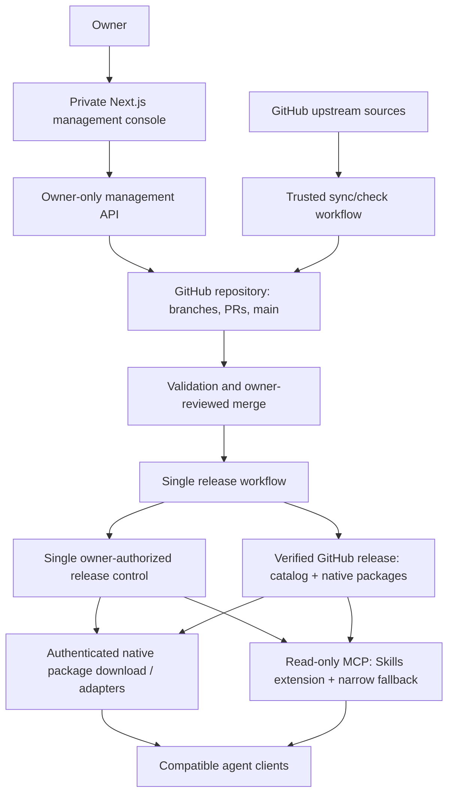

# SPEC-001 — EGAPlugin: Personal Plugin Management, Upstream Lifecycle & Agent Distribution

| Field | Value |
| --- | --- |
| Status | Revision 5 — consolidated proposed baseline for owner sign-off; EP-001 feasibility gate required |
| Revision | 5 — supersedes Revision 4 on owner approval; protocol/SDK/hosting audit and execution clarifications |
| Date | 2026-11-25 |
| Target product | EGAPlugin v1.0 |
| Target repository | EGA-BUILDS/EGAPlugin — private content must remain private; confirm actual visibility in EP-001 |
| Predecessor | egawilldoit/ega-skills |
| Audience | Product owner, implementation agents, independent reviewers |
| Scope | Single-owner plugin and skill management, selective upstream sync, native packaging, standard Skills over MCP, evidence-based compatibility, deferred Code Mode |

## 1. Executive decision

Build a new, small, plugin-first application rather than adding another generation of contracts to EGA Skills. The new product manages the instructions and tools that agents consume; it does not replace the agents' native skill selection, installation, orchestration or execution engines.

The central use case is: import a skill from an external repository, decide whether to follow the author's version or maintain an adapted copy, review upstream changes whenever they happen, and publish the approved result into an installable plugin. One management console is the owner's control point; Git is the source of truth; native packages and MCP are two distribution surfaces for the same approved material. The official Skills extension is the preferred remote distribution interface; native packages remain necessary for clients without native remote skill support. Code Mode is deferred by default and is not a new source of truth.

Start with one plugin and one owned test skill; use controlled upstream fixtures to prove both external management modes, then import only content explicitly selected by the owner. Design for multiple plugins, not multiple organizations. No source, author, plugin name, skill count or example in this document is a mandatory dependency. Do not delete the existing platform until the replacement proves its complete lifecycle in real clients.

This document is a design proposal and execution contract. It does not authorize destructive changes to the existing repositories, databases, credentials or deployments, and does not claim implementation or client compatibility already exists.

### 1.1 Requirements versus examples (normative)

| Item | Classification |
| --- | --- |
| Generic compatible GitHub source onboarding and selected skill/plugin imports | Required |
| Tracked, customized and owned modes; provenance and local-edit preservation | Required |
| Upstream monitoring, reviewed updates, publication and rollback | Required |
| Native distribution and authenticated read-only MCP | Required; official Skills extension preferred and subject to conformance/feasibility gate |
| Code Mode | Documented defer/reconsider decision required; no implementation in v1 unless separately approved on measured evidence |
| Matt Pocock, PStack, Anti-slop and any other named upstream | Illustrative candidates only |
| Particular skill names, roots, plugin names and content counts | Owner-selected examples, not dependencies or exit gates |

Architectural rule: onboarding the next compatible repository must require configuration and content selection, not new application code. Controlled fixtures prove generic behavior; real external sources are optional compatibility evidence and owner-selected adoption targets.

## 2. Context and present situation

The purpose is to replace an increasingly expensive-to-maintain personal skill management system, not to redesign its interface or create another agent framework. A skill should be a portable folder; a plugin should be a distributable collection of skills and supported configuration. The owner needs a single control point to add, edit, organize, watch, compare, remove and publish capabilities while each agent uses its own native runtime. Git provides history and review, rather than a second custom registry.

The original EGA Skills platform was designed as a deterministic, local-first resolver, then expanded into a hosted registry with an administrative console, authentication, immutable release machinery, multi-user controls, and upstream intake contracts. Those choices addressed reproducibility and security but now impose a large maintenance burden on personal skill management.

The previous review in this project verified main at d0bd785aba40b13d0576acb6d50810b02f206832 (2026-11-23, PR #207), root package version 2.0.1, 772 tracked files, 10 internal packages, 153 documentation files, 268 files under tests/, 51 scripts and 13 Supabase migrations. These are historical observations of that revision, not a fresh audit of production health or a measure of code quality. The README described an empty active catalog reset; issue #208 recorded a historical zero-skill production release. Verify both branch and live state before migration.

The pending v2.1 work was organized as #208 specification, #209 preflight and Contract B, #210 Matt Pocock adoption, #211 generic sync, and #212 PStack adoption. All were open in that review. No repository creation or visibility change, T3 registration, deployment, credential or migration is authorized by this specification. Their security and lifecycle requirements are valuable; their implementation assumptions belong to the old platform. Do not execute those issues in parallel with the new build without an explicit owner decision.

Modern agent tooling provides portable SKILL.md folders and native plugin packaging. MCP now also has an official Skills extension for remote discovery and retrieval. The new platform should reuse these primitives rather than build its own skill-loading protocol. See §2.3, §14 and §22.

### 2.1 Current pain points

- A simple add or update crosses numerous registries, source contracts, release artifacts and deployment gates.
- Custom routing metadata and content levels duplicate parts of native agent skill discovery.
- Project fingerprints and custom lock policies are more elaborate than this personal use case needs.
- The current source/editor/publisher boundary is difficult to reason about and maintain.
- The owner needs a clear answer to: where did this skill come from, what did I change, what changed upstream, what is installed, and what should I do next?
- Existing multi-user administration, quota and telemetry facilities are not needed for the first release.

### 2.2 Target user journeys

1. Tracked upstream skill (e.g., any compatible skills repository): reuse selected skills unmodified; watch the upstream branch; inspect changes; approve an exact update; publish; refresh clients.
2. Customized upstream skill (e.g., a skill from a third-party plugin): copy selected instructions; adapt them to the owner’s workflows; preserve the original baseline; compare incoming changes against local changes; accept selectively or reject; never overwrite local adaptations silently.
3. Owned: author a personal engineering skill; edit and version it; distribute it without any upstream dependency.
4. New source: paste a GitHub URL, discover candidate skill roots, choose a destination plugin and mode, review dependencies/license, and import without a code change.
5. Agent: install a compatible native plugin, or connect to authenticated MCP and discover remote skills through the host's Skills extension. Load instructions and supporting files only as needed; identify the version actually consumed. A tool-only fallback is explicit and does not count as native loading.

### 2.3 Why the distribution design changed (Revision 4, retained in Revision 5)

On November 24, 2026, Anthropic announced public beta Skills over MCP. The official extension, SEP-2640, defines the discovery and retrieval interface; the proposal is Final, while implementations remain at differing maturity levels. The TypeScript SDK v2.4.0 release already includes a Skills implementation (its attachment API is experimental). This is not a reason to change Git storage, approval or the owner UI. It is a reason to remove the planned proprietary remote delivery protocol wherever standard support exists.

| Revision 3 assumption | Revision 4 decision | Expected gain / limitation |
| --- | --- | --- |
| Six custom reader tools form the principal MCP interface | Official discovery and resources form the principal interface; only tested compatibility tools remain | Less custom schema, loading guidance and duplicated retrieval logic; not a guarantee of smaller code until measured |
| Model searches then retrieves instructions manually | Compatible host discovers metadata and loads on demand | Better native integration; no promise that a model always selects the right skill |
| Custom content metadata for each reader | Derive standard frontmatter and complete file manifests from the verified release | Standard integrity checks; still need trusted release authorization and secure packaging |
| Native plugins plus custom MCP | Native plugins plus standard MCP, with narrow fallback | One approved source, two delivery paths; clients without the extension still need native packages or explicit retrieval |
| Optional Code Mode POC considered after integration | Defer by default; reconsider only for remaining multi-operation needs | No execution sandbox merely to discover/read skills |

These are projected engineering benefits, not measured savings. The implementation tracker reports ChatGPT/Codex support planned, Hermes work in progress and experimental OpenCode work. Do not confuse a working MCP tool connection with native Skills support. The new protocol does not distribute an entire native plugin, install arbitrary third-party MCP servers, run scripts on the hub or provide upstream lifecycle management. Tasks, Elicitation, File Uploads and MCP Apps are not requirements for this read-only hub.

### 2.4 Revision 5 evidence-based corrections

The repository was rechecked through GitHub on 2026-11-25: EGA-BUILDS/EGAPlugin exists, default branch is main, visibility is public, reported size is zero, and the contents endpoint reports an empty repository. Admin permission is available to the connected owner account. This is an observed repository state, not proof of the organization plan or of private protection capability. No code, committed spec or deployment was available to audit in that repository. Do not push private instructions, source snapshots or credentials to it while public. The owner must explicitly approve the privacy decision before bootstrap publication. Changing visibility is not authorized by this document.

A second review read the complete prior specification, official extension repository and released Beta specification, Agent Skills format, SDK implementation skill and server reference, implementation tracker and hosting limits. SEP-2640 being Final is distinct from the extension lifecycle being Beta; the published Beta schema can change between revisions. Pin both SDK version and extension schema commit/tag for implementation evidence. Reading docs or a moving main branch is not a successful runtime integration. The standard provides a delivery binding, not a plugin manager or an agent runtime.

The review retains the management model and unified release control. It specifically closes gaps concerning loader omissions, protocol revision negotiation, release-scoped pagination, private caching, hosted response sizes, and actual client eligibility. See §14, §20 and §23.3 for exact decisions and tests.

## 3. Scope and non-goals

### 3.1 In scope for the target release

- Private, single-owner dashboard; one canonical repository; multiple plugin definitions supported, one initial plugin.
- Plugin creation, metadata editing, skill assignment, disabling, removal, export and release history.
- Skill authoring and import, full folder management, tracked/customized/owned modes, source provenance, explicit review, update detection, conflict handling and rollback.
- GitHub sources, explicit selected roots, pinned commits, preserved original snapshots, license and companion-file verification. Discover individual skills or skills grouped in a compatible upstream plugin. A full compatible plugin can be adopted through the same generic selection flow, preserving supported manifest configuration and resolving dependencies; unsupported executable hooks, agents and vendor-specific components are reported and excluded only with explicit review, or the import is blocked. No automatic import of external MCP credentials or executable configuration.
- Native Agent Skills distribution, verified client-specific packaging, authenticated read-only MCP with the official Skills extension, narrow compatibility fallback where proven necessary, operational health and release identity.
- Document a default Code Mode deferral; no sandbox implementation unless a separate owner-approved amendment demonstrates benefit after standard MCP works.
- Migration inventory and safe cutover from the predecessor.

### 3.2 Explicitly out of scope

Public marketplace, billing, organizations, teams, roles beyond owner/read access, embeddings, AI router, custom task fingerprinting, proprietary L0/L1/L2 format, custom lockfile engine, database-backed skill registry, separate object storage, plugin execution sandbox written by EGA, automatic third-party code execution, automated merges, browser-based arbitrary command execution, multiple publishers, live bidirectional client synchronization, integration of every existing EGA service, remote management MCP, MCP Tasks/Elicitation/File Uploads/MCP Apps for v1, and live federation of upstream MCP servers. Do not turn this into a new general-purpose agent framework.

## 4. Architectural decisions

| ID | Decision | Rationale / constraint |
| --- | --- | --- |
| ADR-01 | Use EGA-BUILDS/EGAPlugin; private content must remain private; preserve legacy | Confirm visibility and plan before pushing private material; no destructive rewrite |
| ADR-02 | GitHub is canonical for content and provenance | Native history, diffs, branches, pull requests and releases |
| ADR-03 | Standard Agent Skills folders | Avoid proprietary instruction format; preserve resources |
| ADR-04 | One initial plugin, generic data model | Avoid premature marketplace complexity |
| ADR-05 | Selective vendoring with retained upstream baseline | Supports partial repository imports and customization |
| ADR-06 | Explicit review and enforced release gate | Native branch protection preferred; validated fallback only with owner acceptance |
| ADR-07 | Verified GitHub releases are the sole publication boundary | Native immutable releases preferred; independently anchored integrity required if unavailable; one owner-controlled activation/withdrawal record (§12.2) |
| ADR-08 | Single Next.js app and shared TypeScript core | Minimize deployables; isolate credential scopes; split deployment only if required by threat model |
| ADR-09 | No new skill database | Derive catalog from Git; GitHub PRs are drafts |
| ADR-10 | Official Skills extension first; minimal tested fallback; Code Mode deferred | Reuse SEP-2640 and supported SDK; no bespoke router or execution infrastructure |
| ADR-11 | Client adapters, not claims of universal compatibility | Installation, updates and discovery differ by host |
| ADR-12 | Separate owner writes from read-only agent access | A reader cannot change skills or publish releases |

Use supported stable versions at implementation time, pin dependencies and record verified compatibility in the repository. The official Skills SDK adapter is an explicitly reviewed beta/experimental exception; it must pass EP-001 and cannot be silently substituted with handwritten wire handlers. Pin the exact server/client package versions and the released extension schema revision (commit SHA), rather than a moving main or mutable Beta schema URL. Do not upgrade unrelated systems just to match a new framework version.

### 4.1 Architectural complexity budget (normative)

| Area | Initial limit | Change gate |
| --- | --- | --- |
| Storage | Git and GitHub release assets; one small trusted release-control record only; no application database or object store | Demonstrated unmet requirement and owner-approved ADR |
| Runtime | One Next.js app, shared TypeScript modules; no microservices | Proven security or runtime isolation requirement |
| Background work | GitHub Actions, manual triggers and one daily check | Measured workflow limit; no queue or scheduler service by default |
| Search and selection | Native Skills discovery; simple lexical filtering for console/compatibility only | No custom router, embeddings, project fingerprint or lock engine in v1 |
| UI | Four navigation areas; plain text editing and GitHub PRs | No browser IDE or conflict editor in v1 |
| Auth | One proven existing standards-compliant provider | No bespoke OAuth server or automatic paid service |
| Release | One release workflow, one verified stable distribution boundary, one activation/withdrawal control record | No alternative publisher, independent mutable registry or second catalog |
| Users | One owner; narrowly scoped reader access | No multi-user features, billing, quotas or broad telemetry |
| MCP | One authenticated endpoint, official Skills SDK adapter; at most three compatibility reader tools plus optional release identity tool | Evidence of a required unsupported client; no custom skill protocol |
| Code Mode | Deferred, no additional infrastructure in baseline | Measured benefit, isolation and explicit owner-approved amendment |

Every additional package, durable store, deployment or workflow needs a concrete unmet requirement, alternatives considered, cost and maintenance impact, and an owner-reviewed change to this specification. Prefer deletion or reuse before addition. Tests must prove behavior rather than enforce a growing hierarchy of specification contracts.

### 4.2 Technology baseline and unresolved selections

| Layer | Decision |
| --- | --- |
| Runtime and app | Node.js LTS, TypeScript strict, Next.js App Router, one deployable by default |
| UI and validation | Tailwind CSS, minimal shadcn/ui components as needed, Zod or existing validated schemas |
| Build and tests | pnpm lockfile, ESLint/Prettier or existing equivalent, Vitest, Playwright; use existing bootstrap if present |
| Source and review | Git, GitHub PRs, GitHub Actions; native Git merge facilities |
| Publication | GitHub Releases, one verified activation record; no application database |
| Remote distribution | Official TypeScript MCP SDK v2 server/client, ext/skills beta support; exact pin and compatibility gate in EP-001 |
| Authentication | Supabase OAuth server candidate, not committed until issuer/audience/resource and real-client proof |
| Hosting / release control | Vercel Node runtime and Global Config candidate; plan, cost, capacity and propagation verification required |
| Code Mode | Deferred; no SDK, service or sandbox dependency in baseline |

Use the smallest working dependency set. Do not infer that the owner has a paid account, an eligible Claude plan, working OAuth, or permission to provision infrastructure. No framework migration or shared library across EGA projects is required.

## 5. System architecture



### 5.1 Logical layers

| Layer | Responsibility | Must not do |
| --- | --- | --- |
| Web UI | Browse, edit, review, show publication and install state | Access GitHub secrets in browser; publish directly |
| Management API | Owner auth, server-side validation, prepare Git commits/PRs | Bypass merge protection; execute skill content |
| Shared core | Parse, inspect, compare, validate and package content | Maintain a second authoritative registry |
| GitHub sync workflow | Fetch selected upstream data at exact SHAs, detect changes | Auto-approve, execute upstream scripts or publish |
| GitHub release workflow | Package reviewed main revision; prepare verified release for owner-authorized activation | Use an unreviewed PR or floating upstream branch |
| MCP | Advertise standard Skills extension; serve manifests and files from current verified release; narrow read fallback | Write Git, expose drafts, serve another release, or run scripts |
| Client adapters | Generate tested client manifests/install instructions | Fork the canonical skill content silently |
| Code Mode (deferred) | Reconsider only after measured need | No execution infrastructure in baseline |

### 5.2 State boundaries (critical)

- Draft: branch and PR; can contain proposed changes and conflicts (conflict details are proposal metadata, not publishable files).
- Approved source: main after owner review and CI; enforce branch protection when available and otherwise the release gate in §12.1. It may be ahead of publication.
- Published: designated verified, non-draft stable GitHub release activated via the trusted promotion control, subject to the revocation and cache policy in §12.2; only this is eligible for normal MCP and download access. A release always identifies one exact main commit.
- Installed: a client-local snapshot or platform-managed plugin revision; independent of the current published version. The console must not claim that a remote client updated unless it has real evidence.
Never use main or an upstream HEAD as the live MCP content source. Drafts, rejected versions, local merge conflicts and disabled skills must not leak into new artifacts.

### 5.3 Deployment

One Next.js application on Vercel (Node runtime for server operations), with /mcp implemented through the supported MCP SDK/HTTP adapter and /api/admin/* for owner actions. Share code via ordinary TypeScript modules; no service mesh or ten-package monorepo. GitHub Actions runs slow upstream checks and packaging outside request paths. Supabase Auth is a candidate, not a committed dependency. EP-001 must test real target-client OAuth flows using isolated disposable test configuration; choose an existing standards-compliant provider only after evidence of correct audience/resource enforcement, owner identity and client compatibility. Do not modify legacy auth. Use server-only credentials scoped by operation; the MCP handler must have no path to owner mutation helpers. If runtime-level isolation of write secrets is required, deploy the read endpoint separately with the same shared core; document the reason and cost. No custom OAuth server. No new skill database.

MCP reads verified release assets through a repository-scoped, read-only server credential. Prefer the official TypeScript SDK v2 (@modelcontextprotocol/server), starting with the verified v2.4.0 Skills capability; pin the compatible release selected in EP-001. Use request-scoped authorization and immutable release-derived storage; never attach an unrestricted filesystem directory or globally mutable skill catalog. Keep private repository artifacts private, and do not pass GitHub tokens to client agents. Private plugin installation uses authenticated download and local marketplace registration where supported; platform-specific remote installation is a compatibility gate, not an assumption.

## 6. Repository and source model

```text
EGAPlugin/
  app/                         # Next.js pages + route handlers
    api/admin/
    mcp/
  src/
    core/                      # validation, diff, merge planning, packaging
    github/                    # repository adapter
    auth/                      # owner session + MCP authorization
    mcp/                       # official Skills adapter + narrow compatibility readers
  plugins/
    <plugin-id>/
      plugin.json              # canonical portable manifest, verified in EP-001
      mcp.json                 # optional remote MCP config; no secrets
      skills/
        <skill-id>/
          SKILL.md
          references/          # optional companion content
  catalog/
    plugins.json               # IDs, enable state and display metadata
    sources.json               # source definitions + per-skill provenance
    decisions.json             # at most one active suppression per skill
    release.json               # desired catalog version; not a runtime pointer
  upstream/
    <plugin-id>/<skill-id>/    # exact accepted upstream skill tree
  provenance/
    <source-id>/<commit>/      # exact license/NOTICE paths at accepted revision
  scripts/                     # thin CLI entrypoints over src/core
  tests/                       # focused unit, integration and client tests
  docs/
    specs/SPEC-001.md
    operations.md
    compatibility.md
  .github/workflows/
    ci.yml
    upstream-check.yml
    release.yml
  AGENTS.md
  README.md
```

This is the canonical initial layout: one application, ordinary modules, one source catalog, no workspace package hierarchy. The source metadata owns provenance; the plugin manifest owns portable packaging fields. Do not duplicate writable metadata across both. Derive release projections and adapters in CI.

Use unique IDs (plugin-id/skill-id) and portable lowercase folder names. Validate Agent Skills naming rules, including the 1–64 character skill name, no leading/trailing or consecutive hyphens, matching folder/name, nonempty description up to 1024 characters, and optional-field constraints. Choose a conservative portable ASCII subset for EGA v1; reject unsupported names or require reviewed customization rather than renaming tracked content silently. Do not silently rename imported skill instructions to resolve collisions; offer an explicit rename/customization with validated references. For tracked skills, the canonical folder bytes must match the accepted source selection. All generated client manifests are derived from canonical metadata; no manually maintained duplicate content. Keep provenance and upstream snapshots out of distributed packages except required notices and a compact source manifest. Use git mv or an equivalent reviewed operation for moves; stable IDs change only through an explicit migration when necessary.

### 6.1 Example source metadata (illustrative, not a final JSON schema)

```json
{
  "schemaVersion": 1,
  "sources": {
    "matt-pocock": {
      "repository": "https://github.com/mattpocock/skills",
      "ref": "main",
      "watch": true
    },
    "cursor-pstack": {
      "repository": "https://github.com/cursor/plugins",
      "ref": "main",
      "watch": true
    }
  },
  "skills": {
    "ega-engineering/diagnosing-bugs": {
      "mode": "tracked",
      "enabled": true,
      "sourceId": "matt-pocock",
      "sourcePath": "skills/engineering/diagnosing-bugs",
      "acceptedCommit": "<full-upstream-commit-sha>",
      "acceptedTreeDigest": "sha256:<digest>",
      "baselinePath": "upstream/ega-engineering/diagnosing-bugs",
      "licensePaths": ["LICENSE"],
      "watch": true
    },
    "ega-engineering/principle-fix-root-causes": {
      "mode": "customized",
      "enabled": true,
      "sourceId": "cursor-pstack",
      "sourcePath": "pstack/skills/principle-fix-root-causes",
      "acceptedCommit": "<full-upstream-commit-sha>",
      "acceptedTreeDigest": "sha256:<digest>",
      "baselinePath": "upstream/ega-engineering/principle-fix-root-causes",
      "licensePaths": ["pstack/LICENSE"],
      "watch": true
    },
    "ega-engineering/engineering-preferences": {
      "mode": "owned",
      "enabled": true,
      "sourceId": null
    }
  }
}
```

The actual schema must reject unknown modes, missing baseline fields, duplicate IDs, invalid relative paths, inconsistent references, orphan snapshots and illegal mode transitions. Derive the provenance directory from validated sourceId and acceptedCommit; do not persist a redundant provenancePath field. Reject that field in canonical source records and reject any reference inconsistent with the derived path. Verify the source branch and license paths at import; the example paths are candidate roots from the old specification, not a guarantee they still exist. Preserve license bytes with snapshots. Key baseline paths by full local skill identity (never a source leaf name alone); distinct frontend/review and backend/review require distinct local IDs or explicit conflict resolution. Store source-level notices under provenance/<source-id>/<accepted-commit>/<original-relative-path> and reuse a snapshot for all referencing skills. Retain every referenced license snapshot, include required notices in the packaged skill/plugin, and remove an unreferenced active snapshot only in a reviewed change; Git history remains. For nested or per-file licensing, record all applicable paths. A skill move/rename updates the full ID, baseline path, references and decisions atomically; the original source identity/path stays unchanged. Use standard SHA-256 of a sorted manifest of relative path, byte digest and allowed file type/mode to compare trees; use Git commit IDs for Git revisions. Do not invent another content-addressed storage engine.

### 6.2 Entity ownership

Plugin: stable ID, name, description, enabled state, skill membership, configured MCP capabilities. Skill: ID, root, mode, enabled state, origin, accepted baseline, local content and optional change rationale. Source: repository identity, tracked ref, watch setting, selection and license information. Proposal: a GitHub PR containing the actual candidate diff and pinned comparison metadata. Release: verified tag, source commit, catalog version, asset hashes and generated plugin bundles; native immutability or approved independent integrity control. Watch report: operational status, not authoritative skill content.

## 7. Skill management modes and transitions

| Mode | Local edits | Upstream updates | Required invariant |
| --- | --- | --- | --- |
| Tracked | Not permitted without mode conversion | Review exact new upstream copy | Local content equals accepted upstream selection |
| Customized | Allowed through reviewed edit | Three-way comparison | Original accepted baseline remains separately retained |
| Owned | Allowed | No upstream watch | No external source dependency; preserve attribution if derived |

Tracked → Customized requires explicit confirmation and preserves source/baseline. Customized → Tracked requires a reviewed replacement with exact upstream bytes; show local changes that will be discarded. Pausing or stopping tracking sets watch=false indefinitely while preserving mode, origin, baseline, content and attribution; resume explicitly or manually check. Source removal with retained imported content means disabling its tracking, not deleting its provenance. Scheduled eligibility is the conjunction of the source-level and skill-level watch flags; disabling a source pauses all of its selections without erasing per-skill settings. Resuming a source does not implicitly resume a separately paused skill. Explicit manual checks remain possible against retained provenance. Customized → detached/Owned is deferred; the owner need not convert to Owned to stop tracking. Owned skills may be linked to an upstream only by explicit reviewed reconciliation, never automatically. Disabling or pausing watch is orthogonal to mode. Removing a skill deletes it from future packages and live MCP after publication; Git history remains. Neither disabling nor removing automatically revokes files already installed on client machines.

## 8. Complete import and editing lifecycle

### 8.1 Import

1. Owner supplies an allowed GitHub HTTPS repository URL and ref. Resolve its repository identity and exact full commit SHA; never fetch arbitrary user-provided network destinations.
2. Enumerate bounded tree metadata and identify directories containing SKILL.md. Do not import the full repository. Owner selects root(s), target plugin, management mode and required license/companion paths.
3. Fetch exact selected files at the resolved SHA; inspect YAML, relative references, cross-skill requirements, assets, scripts, vendor fields, notices and runtime assumptions. Display any incompatibility; do not silently normalize tracked content.
4. Retain original snapshot plus provenance and required notices. For a tracked skill use unchanged bytes; for customized skill allow reviewed edits. Do not run imported code.
5. Create draft PR containing the actual files, metadata and review summary; validate full diff. Owner reviews final head and merges after CI. Publication is separate (§12).

### 8.2 Edit, move, disable, delete

- Edit owned/customized SKILL.md using a plain Markdown textarea or Git editor; companion-file edits and complex conflicts use GitHub or local Git in v1; create PR from known main SHA. Tracked edit first requests conversion. Preserve original snapshots unchanged.
- Move skill between plugins as one atomic Git commit, updating membership and affected references; check duplicate names per client.
- Disable skill/plugin by metadata change, exclude from new exports and MCP index; keep editable source content. Re-enable requires reviewed release.
- Delete selected skill via impact preview and confirmation; remove active source mapping/baseline from current tree when no longer required; keep history and notices for remaining content. Removing a source with imported skills requires explicit choices for all affected skills; never silently remove them.
- Reject stale edits with a conflict response; do not overwrite a concurrent update. Existing GitHub branch and file SHA preconditions are sufficient when correctly applied; recheck target base before merge.

## 9. Upstream watching and discovery

Daily scheduled GitHub Actions check, plus manual “Check now”. Schedule is best effort; expose last attempted and last successful time, failures and stale data. A generic new source uses data configuration only, not a new workflow or code path. One source fetch may cover several selected skills.

For each source, resolve the tracked ref once to an exact commit. Compare each selected tree and required license/provenance files against its accepted baseline. Compare full file sets, bytes and safe modes, not just SKILL.md or the repository head. Discover new unselected roots separately. A changed commit with identical selected content and licenses is not a publishable update.

| Observation | Required behavior |
| --- | --- |
| No material change | No PR, version bump or deployment |
| Selected root changed | Draft update proposal with exact candidate commit and diff |
| New unselected root | Discovery report only |
| Root missing | Warn; retain published copy, offer explicit removal/remap |
| Possible rename | Suggest a remap; do not infer identity automatically |
| License changed or unknown | Block import/update pending review |
| Fetch failed / rate limited | Mark error, keep accepted baseline, retry with bounded backoff |
| Exact candidate previously rejected | Suppress duplicate proposal; show on demand |
| New different candidate | Reopen review eligibility; prior decisions remain in Git history |
| Existing proposal under review | Do not mutate its reviewed head automatically; report newer candidate |
| Watch paused | No scheduled checks for that skill; manual check still available |

Use a single operational GitHub issue (or equivalent simple GitHub-native status record) for latest watch summary; detailed results stay in Action logs and PRs. It is not a second catalog. Allow one open auto-proposal per skill and candidate group; coalesce independent compatible changes only if review remains clear. Serialize proposal creation; use stable identifiers and recheck open PRs before writes. Never create recurring no-op commits.

Active suppression is bounded: catalog/decisions.json contains at most one latest rejected/explicitly ignored candidate per managed skill, keyed by skill ID, source identity/path and candidate content + provenance digest (with commit for evidence). An unrelated commit with identical candidate content does not reopen a rejection. A materially different candidate remains eligible; a new rejection replaces the previous active record. Prune the active record atomically when a newer candidate is accepted, when a skill is removed, or when its source mapping is explicitly changed; preserve history in Git. Deferral without explicit ignore is not a permanent suppression. Manual review can reopen a suppressed candidate. Report ignored records without generating releases.

## 10. Customized update contract

### 10.1 Three-way model

```text
BASE   = exact upstream selection last accepted, retained under upstream/
OURS   = current EGA skill from approved main
THEIRS = new upstream selection at a pinned commit
RESULT = reviewed combination of OURS and THEIRS relative to BASE
```

Use Git's merge facilities, such as git merge-file for eligible UTF-8 text files. The trusted planner must classify file additions, deletions, mode changes, binaries and path collisions across the whole tree. It may use an isolated temporary Git tree for directory-level merge semantics; do not assume a file merge command handles directory renames or binary data. Git tooling runs only fixed trusted commands with argument arrays, no shell interpolation or untrusted Git configuration/hooks/filters. For v1, ambiguous renames, binary conflicts and overlapping edits require manual resolution rather than an automatic heuristic.

| Base/ours/theirs condition | Candidate result |
| --- | --- |
| Ours unchanged; upstream edited | Adopt upstream change in candidate |
| Upstream unchanged; ours edited | Keep local edit |
| Both changed disjoint text | Produce merge candidate, still require review |
| Both changed overlapping lines | Conflict; owner resolves |
| Both add same path differently | Conflict |
| Upstream deletes locally unchanged file | Proposed deletion, dependency check |
| Upstream deletes locally modified file | Conflict; retain until resolved |
| Local deletion, upstream modification | Conflict; never resurrect silently |
| Binary changed on one side only | Show change, require explicit review |
| Binary changed on both sides differently | Manual choice |
| License/provenance changes | Block until reviewed regardless of merge status |

A successful mechanical merge does not mean the instructions are semantically correct. Owner/reviewer must assess policy contradictions, instructions referring to different agents, dependencies, security and intent.

### 10.2 Owner decisions

- Accept upstream (tracked): candidate content becomes exact new selection; advance accepted baseline only after merge of the reviewed PR.
- Merge/customize: resolve all conflicts, preserve wanted local edits, set baseline to the complete new upstream selection and local content to the approved merge result. Advancing the baseline records what upstream version has been reconciled; deliberately excluded upstream changes become local divergence against that new baseline. Explain this in the review summary.
- Reject candidate: keep BASE and OURS unchanged; store candidate digest and source identity in rejection record through a reviewed metadata-only commit. Rejection of one tree is not rejection of all future revisions.
- Defer: leave the proposal open or close it without recording a permanent rejection; allow manual reopening. No baseline advancement.
- Replace with upstream: explicit destructive preview of discarded local differences, convert to tracked only if exact source bytes are restored.
Every proposal binds source repository/ref, old main commit, old baseline digest, candidate upstream commit and tree digest, proposed content digest, affected skill IDs and final PR head. Any change requires recomputation and renewed approval. A new source head does not invalidate an already pinned candidate by itself; show that a newer revision exists. Concurrent local changes do invalidate stale merge candidates.

### 10.3 Illustrative example (not a requirement)

The owner imports PStack's root-cause principle, adds a requirement for independent review in T3, and publishes. Upstream later adds a reproduction requirement. The planner compares the old original, local customized text and new original. If edits do not overlap, it produces a candidate containing both rules. If they conflict, the owner edits the candidate and reviews it. On merge, the new original becomes BASE and the adapted copy remains OURS. No custom change is lost through blind reinstallation.

## 11. Management console and API

### 11.1 Four navigation areas

| Area | Required capability |
| --- | --- |
| Plugins | List/create/edit metadata, assign skills, enable/disable, publish status, download verified bundle |
| Skills | Search/filter by mode/source/status, import, simple Markdown textarea, move/remove, provenance and history |
| Sources | Add compatible source, select roots, watch status, available updates, ordinary file diffs and PR links, check/pause/resume |
| Settings | Connection configuration, verified installation instructions, release history, rollback proposal and operational status |

Status summaries and skill details are inline views, not separate top-level products. The console is desktop-first and responsive, with accessible controls, keyboard navigation, loading/error/empty states. The minimum console provides browsing, status, simple SKILL.md editing and PR preparation; it may preview ordinary bounded file diffs. Complex companion editing, conflicts and final approval/merge use GitHub PRs or local Git. No custom rich editor, visual three-way merge workspace, browser IDE, direct publish button bypassing review, or extra administrative screens. Every mutation creates or updates a proposal and shows the link and current state; an unresolved conflict has no publishable candidate. Provide precise fallback instructions. Implement this UI only after real native and remote consumption have been proven.

### 11.2 Minimal server contract

Use ordinary typed route handlers; names below are indicative, not a requirement for one handler per verb.

| Operation | Result |
| --- | --- |
| GET catalog / plugins / skills / sources | Owner view of main and published identities |
| GET skill detail / history / diff | Bounded file content, provenance and candidate state |
| POST source discovery / check | Bounded read or trigger trusted check workflow |
| POST change proposal | Create/update draft PR with expected base/head; validated operation |
| POST decision | Record accept/reject/defer by creating/updating a PR (candidate files or catalog/decisions.json as applicable); never write directly to main or merge |
| GET releases / artifact | Verified metadata and authenticated download |
| POST rollback proposal | PR restoring selected previously approved content with new version |

Errors are structured (code, safe message, requestId, retryable flag). Distinguish unauthenticated, forbidden, invalid input, stale conflict, unavailable upstream, rate limit, not found, and internal errors. Never leak GitHub tokens or raw provider diagnostics. Validate every write server-side; use CSRF defenses for cookie-authenticated mutations, origin checks and owner authorization. Set request/file bounds before expensive work.

## 12. Publication, versioning and rollback

### 12.1 Single release authority

Use GitHub Releases as the canonical distribution boundary, preferably with repository release immutability enabled and verified. Main is desired state. A single trusted release workflow runs against an exact main commit after validation and explicit owner merge. The owner authorizes publication of the exact reviewed commit; use a trusted manual dispatch if native branch protection/approval cannot enforce the policy. GitHub does not allow a PR author to approve their own PR as a qualifying review; do not require a sole owner to fake a second account or bypass required reviews. Prefer an independent permitted reviewer plus owner authorization; where unavailable, define a separate explicit owner authorization of exact head and independent agent review evidence, with residual enforcement limits recorded. Do not equate agent review evidence with a GitHub-enforced human approval. It must not execute imported scripts. Use simple semantic versions for the catalog; v1 may align the initial plugin version with the catalog version. Bump the catalog version for a change to active content, plugin configuration or distribution contract. Metadata-only watch decisions, docs and rejected proposals do not require a release. Validate that changed plugin bundles have updated version metadata; when multiple plugins exist, unchanged bundles may retain their individual version.

Build from the exact merged main commit, not floating references. Produce:
- catalog.json: schema version, release version, exact source commit, enabled plugin/skill metadata, approved text content or bounded file records, SHA-256 hashes and provenance. Private artifact; exclude original comparison snapshots, drafts, secrets and disabled skills.
- One native plugin archive per enabled plugin with portable skills, licenses, notices and client-specific adapters only as supported. The catalog contains enough exact file bytes/records to derive each eligible remote skill manifest without a new artifact publisher. Include remote eligibility and explicit native-only reasons; validate the remote projection in the same release workflow (§14).
- checksums.sha256 plus human-readable release notes. Record GitHub asset digests and validate all assets before promotion.
Create draft release with all assets, verify archive contents and expected catalog identity, then publish a stable release eligible for owner-authorized activation. GitHub’s latest designation is informational only. The workflow is serialized, validates that the target is still intended for release and that the new version is monotonic, and refuses an existing immutable tag with different content. Do not move tags or overwrite published assets. Native immutable releases protect tags and assets, not all release metadata (including latest designation); do not use mutable notes as trust anchors.

Plan-dependent controls. EP-001 must record actual repository visibility, account plan, rule/approval capabilities, immutable release setting and attestation availability. Prefer private repo with enforced branch protections and immutable releases. If protected main is unavailable, retain owner-only merge policy, require successful exact-head CI and a trusted release job that verifies the target is an approved merged PR with reviewed content/head and expected main commit, and require owner dispatch against that commit. The release job independently rejects direct/unreviewed changes, including commits between reviewed releases that are not attributable to approved PRs. Do not represent this as equivalent to enforced branch protection; the owner must accept the residual administrator-bypass risk. Do not automatically upgrade plans or make private content public.

If native immutable releases are unavailable, the approved fallback is an independently trusted release manifest/digest, pinned outside mutable release assets in the single owner-controlled record defined in §12.2, or a verified signed/attested manifest with an independently pinned trust identity and the exact approved release identity in that same record. EP-001 selects one supported mechanism and EP-007 tests it; default to explicit digest pinning rather than building custom signing infrastructure. The manifest binds repository identity, version, release ID/tag, source SHA and all asset digests. Fail closed on missing/mismatched trust anchor; tag non-existence and same-release checksums alone are not sufficient. A new version is eligible only after verification and owner-authorized trust-anchor promotion; the anchor is a verification control, not another content store or publisher. The release workflow must be able to recover from a failed draft without reusing a published version. If neither native nor approved fallback meets security requirements within budget, block production publication and return the decision to the owner.

### 12.2 Single active-release control and runtime availability

GitHub Releases is the sole artifact publisher. Exactly one independently authenticated, owner-controlled configuration mechanism selects the active release and permits or stops delivery. Do not poll GitHub's mutable latest designation, use a second active pointer, or implement a separate withdrawal denylist. catalog/release.json is desired source version metadata, not a live pointer. GitHub release notes and latest designation are not authorization or integrity anchors.

Control selection (EP-001). Prefer the existing hosting platform's dynamic configuration primitive if it meets availability, access-control, cost and propagation requirements. For Vercel, evaluate Global Config (formerly Edge Config); it supports updates without redeployment, but propagation and actual plan limits must be verified. An equivalent existing primitive is acceptable, but select exactly one. A static environment variable requiring redeployment does not meet the dynamic withdrawal requirement on its own. Do not provision an application database, separate denylist service, or custom control plane. If no candidate meets the required bound and budget, block production activation and obtain an explicit specification decision rather than silently weakening the requirement.

Use a single small record (illustrative logical fields, not a new protocol):

```json
{
  "schemaVersion": 1,
  "enabled": true,
  "repository": "EGA-BUILDS/EGAPlugin",
  "version": "1.0.0",
  "tag": "v1.0.0",
  "releaseId": "<exact-github-release-id>",
  "sourceCommit": "<full-reviewed-main-sha>",
  "assetDigests": { "catalog.json": "sha256:<digest>", "<plugin-archive>": "sha256:<digest>" }
}
```

The owner-authorized promotion operation validates the complete exact release and asset digests, serializes control updates and prevents lost or regressive promotions; ordinary rollback creates a higher version (§12.3). Prefer explicit owner approval of an exact candidate and one trusted promotion path over automatic activation. Runtime credentials may only read this record; owner/release write authority is separate from both MCP and ordinary management PR preparation. Update the entire record atomically; never activate partially verified fields. Emergency withdrawal sets enabled=false in the same record without consulting GitHub; retain the pinned identity for diagnosis. Re-enable only by an explicit owner action after verification, not automatically after an outage. A withdrawn unsafe identity must not be reactivated by normal promotion or retry; repair by activating a newly verified higher release. The activation record retains its disabled identity, and promotion/re-enable are serialized trusted owner actions, not automatic retries. Verify provider atomic whole-record replacement and writer concurrency guarantees; if CAS is unavailable, enforce a single trusted serialized writer for ordinary promotion and withdrawal, with emergency requests taking priority over stale promotions. Do not claim a race-free kill switch without testing an overlapping promotion and withdrawal. No extra denylist or control store. Before first activation, absent or disabled configuration means unavailable.

Request path. Authenticate and authorize every content request. Read the current trusted control through the selected provider on every request (including MCP discovery, skill listing/get, every resource read/list/template/directory call where supported, compatibility tool calls and authenticated plugin downloads); disable application-level stale control caching. Provider propagation may have a bounded delay, which EP-001 must measure and document; target at most 60 seconds from owner withdrawal across all reachable serving deployments, with a smaller bound preferred. A failed, malformed or unverifiable control read fails closed, including on warm instances. Do not fall back to previously cached authorization. Exclude private content from shared response/CDN caches and prevent direct or old deployment routes from bypassing the control. Serve only the enabled exact identity; fetch that release by ID/tag, not by latest, verify its repository, reviewed SHA, tag, stable non-draft status and asset bytes against trusted digests (and native immutable/attestation evidence when supported). Cache the verified bytes in process-local memory keyed by the complete release identity and digest; coalesce concurrent cold loads. No distributed artifact cache by default. Reuse those bytes while the trusted control continues authorizing that exact identity; no periodic GitHub fetch or artificial cache expiry is required. On promotion, never serve the previous identity as an implicit fallback. Use a single consistent release snapshot per response, with subsequent requests re-reading the control. Bind skill/resource URIs and pagination cursors to the active release as specified in §14; a stale URI must never silently return new bytes. No old release is served after a new identity is selected.

| Condition | Required runtime behavior |
| --- | --- |
| Valid enabled control, exact verified artifact cached | Serve it; no GitHub request required |
| Cold cache or newly selected identity | Fetch and verify exact asset; serve only after successful verification |
| GitHub outage, timeout or rate limit with matching verified bytes | Continue serving while the independently read control authorizes that identity; expose known upstream failure if observed, without inventing a health result |
| GitHub failure with cold miss or different selected identity | Retryable unavailable; no fallback to older release, draft or main |
| Invalid candidate, tampered bytes or integrity mismatch | Reject candidate; do not serve it; owner repairs activation or publishes a reviewed rollback |
| Control absent, disabled, malformed or unavailable | Deny delivery even with a warm verified cache; report unavailable or withdrawn as appropriate |
| Emergency withdrawal during GitHub outage | Same control disables delivery within the measured propagation bound; no separate denylist or redeploy required |

Artifact caching is not authorization caching. Report the selected version, artifact verification time and observed availability to authenticated consumers; do not claim GitHub is healthy merely because the artifact is cached. Liveness is separate from readiness. Use bounded fetch timeouts/backoff and safe public health output. EP-001 proves control update/read behavior, costs and propagation; EP-007 proves publication and promotion with isolated release fixtures; EP-008 repeats delivery/withdrawal tests with actual MCP and download routes, including stale or direct deployment URLs. A future separately approved Code Mode execution would have to recheck authorization on each permitted call and abort if the selected identity changes or is withdrawn; it must not mix versions. In-flight transfers, host-side verified caches, instructions already in model context and downloaded/installed copies cannot be recalled. The 60-second withdrawal target applies to subsequent server delivery only, not deletion or deactivation of remote client state. Direct repository access by an authorized GitHub owner is outside the platform delivery boundary; do not distribute permanent unauthenticated artifact URLs as a bypass. If content or release assets are public, an MCP kill switch cannot withdraw them from GitHub; the private-content baseline therefore requires private artifact storage via the canonical private repository, or an explicitly approved public-content-only scope. No silent split repository or extra artifact store. The server download route must stream verified bytes with private/no-store headers where hosting limits require, rather than redirecting to a durable public or bearer URL. Bound archive bytes and decompression before release; verify the exact deployed download path for a representative largest bundle. Never give the client a GitHub read credential.

Post-publication checks compare actual MCP and authenticated downloads with the selected identity. If promotion fails, the previous control record remains authoritative unless explicitly disabled; if a newly activated release fails runtime verification, fail closed for that identity and report the failure. Repair or publish a reviewed rollback; never claim successful activation without endpoint proof. Historical release metadata is owner-only; normal MCP does not serve arbitrary historical releases. No second artifact store, publisher or active pointer is introduced.

### 12.3 Rollback

Ordinary rollback is forward-versioned: create a PR restoring content and source metadata/baselines from a known-good commit, validate, merge, publish a new higher semantic version. Rejected/disabled content must not be unintentionally restored; review the exact diff. Preserve prior immutable releases and Git history. Do not reset main or rewrite tags. Record the affected installed clients and provide update instructions. A code deployment rollback and a catalog rollback are separate operations; verify both if relevant.

## 13. Agent distribution and compatibility

One canonical approved skill library, two required distribution paths: native packages and authenticated MCP. Prefer official Skills over MCP for remote use where proven, and native Agent Skills/plugin packaging where required. Use current client-specific manifests and installation conventions; generate adapters from the same approved files. No bearer token or private key in a bundle. A skill extension does not publish a whole plugin or install its tool servers. Native manifest and MCP connection remain distinct.

| Target | Evidence as of 2026-11-25 / intended path | Required proof before claiming support |
| --- | --- | --- |
| Claude / Claude Code | Skills over MCP public beta; native plugin remains available | Actual account/version, OAuth, native remote discovery, selection, supporting files, approval and update; test intended interactive/headless mode separately |
| Codex | Tracker: remote Skills support planned; native plugin/local marketplace | Native install, discover, invoke, companion read, update, uninstall; do not assume remote native activation |
| ChatGPT | Tracker: remote Skills support planned; private plugin if supported or read-only tool fallback | Real account connect and tool reads; native install and native remote loading only if separately proven |
| OpenCode | Tracker: experimental work in progress; use supported native skill paths | Actual runtime version/flag, selection, companion access; remote loading unverified until tested |
| T3 Code | Depends on selected agent runtime, not T3 UI alone | Real thread in the intended runtime on owner's Windows and Ubuntu environments |
| Hermes | Tracker: community PR in progress; native mechanism or fallback | Actual installed release/profile, selection and invocation; remote support not assumed |
| Reference client | Official SDK SkillsClient / conformance suite; not a substitute for host UX | Protocol discovery, reads, verification and negative cases with exact pinned SDK |

Sources: Anthropic announcement, Claude Code MCP docs, implementation tracker. Recheck at EP-001 and EP-009; beta, planned and experimental are not production certification. Claude account eligibility and client mode restrictions must be verified; no paid plan assumed or purchased.

Initial required gates remain Codex and OpenCode/T3 native consumption on the owner's real environments, authenticated ChatGPT MCP access with a supported path, and standard extension conformance plus at least one actual extension-capable host if available. If the owner cannot access an eligible host, record the blocker and obtain approval to defer that real-host gate; do not call reference-client proof a real-host pass. Other target paths are explicitly supported, partial, unsupported or untested with exact evidence. No need to wait for all vendors to implement Skills over MCP before shipping proven paths.

Avoid exposing same logical skill simultaneously through native and remote paths in the same client where it causes ambiguous selection; document a preferred per-host configuration. Do not silently overwrite another server's or installed skill's identity. Installed versions update through supported refresh/reinstall behavior, not an automatic guarantee. Remote clients may cache manifests or content and require fresh approval; updates are not instant or forced. Evaluate existing install helpers rather than implementing another installer.

## 14. MCP contract — standard Skills over MCP

### 14.1 Primary interface and SDK

Use one authenticated read-only Streamable HTTP endpoint. Implement SEP-2640 using the supported official TypeScript SDK (@modelcontextprotocol/server, ext/skills), with exact package/protocol compatibility pinned by EP-001. The SDK's v2.4.0 release provides Skills attachment, storage adapters and a verification client; the attachment API is experimental. Prefer its existing helpers and strict validation, not bespoke JSON-RPC handlers. EP-001 must prove safe integration with Next.js, per-request release/auth binding, URI identity, pagination and cache policy. If unsupported, report the exact gap and smallest approved solution; do not silently advertise nonconforming support. Negotiate the client's supported protocol revision and use the correct capability handshake and required metadata for that revision. Target 2026-07-28 for the full cache-aware wire contract; older negotiated revisions only when explicitly supported and tested. The SDK documents support for both its modern and legacy protocol variants; do not assume identical wire shapes. Modern requests include the required params._meta and discover capabilities through server/discover; a legacy client uses the negotiated legacy handshake and result shapes. Do not inject modern-only cache fields or request metadata into older protocol results by hand. Pin the supported protocol/extension matrix and validate both if a required client needs the older variant. Do not force a v2 migration of unrelated services.

| Protocol method | Contract |
| --- | --- |
| Capability discovery | Advertise Resources and io.modelcontextprotocol/skills through the negotiated standard handshake; only advertise directoryRead when fully implemented and release-safe; if SDK attaches it automatically, test it or block that configuration |
| skills/list | Complete entries, parsed frontmatter and full static file manifests; bounded single page initially, standard pagination if release-safe and needed; no instruction bodies on listing |
| skills/get | Exact URI lookup independent of previous listing; return complete entry |
| resources/read | Read only exact authorized file URIs belonging to active release and eligible skill |
| Base Resources methods | Implement the required resource/list/template behavior of the negotiated specification; any advertised surface is subject to the same authorization and release gates |
| resources/directory/read | Optional; implement all declared namespace directories if enabled, otherwise do not advertise it |

Use standard request/result schemas, error codes and cache metadata as defined for the negotiated version. Do not add bespoke mandatory result fields to standard methods. Expose release identity separately via the URI mapping and authenticated release information. A resource read alone does not activate a native skill: activation, approval and selection are host behaviors.

### 14.2 Manifest and content projection

Build remote entries deterministically from the same verified release catalog as native bundles. For each eligible skill, preserve all YAML frontmatter and the exact distributed file bytes, including SKILL.md and every required companion file; use raw-byte SHA-256 and byte length (not hashes of normalized Markdown or JSON encoding). Validate folder/name match, references, MIME/encoding and complete manifest before publication. No generated/dynamic skills in v1. A tracked import cannot be silently rewritten; require explicit reviewed customization or native-only classification for incompatible layout. Shared references outside the skill root must be explicitly packaged/validated without changing tracked bytes; if that is impossible, mark native-only or block the import. Do not publish a partial manifest as a complete skill. Approved scripts or binary assets can remain in native packages; initial remote policy is bounded reviewed text-only skills. A skill with files or dependencies outside that policy is native-only, not an incomplete remote entry. The server never executes content. The host owns any execution/permission approval.

SDK adapter choice and completeness gate. Prefer SkillsExtension.load(memorySkillFiles(...)) for a bounded, immutable verified in-memory release projection; use the documented two-method SkillFiles adapter only if byte handling or measured size makes it necessary. Do not use SkillSource for dynamic per-request generation, mutable filesystem scanning, or a second skill registry. Build the projection from an exact verified release once per identity, attach the extension inside the SDK server factory before connection, and bind the factory to the already authorized request snapshot. Do not register overlapping skill:// resources or write skills/list/`skills/get` handlers by hand. The SDK reference documents that registered resources can shadow extension files, invalid skills can be skipped, and hidden dot entries can be skipped even in strict mode. Therefore enable strict validation where supported and independently compare the expected eligible roots and every approved distributable file URI, byte length, digest and frontmatter against the SDK projection. Fail release validation on unexplained omissions, duplicates, extra files or mismatches. A deliberate native-only classification occurs before projection, with an explicit reason and review; it is not an escape hatch for silent loader loss. Test .hidden files, symlinks, malformed frontmatter, Unicode/encoding and CRLF bytes; do not rewrite tracked content. For v1, exclude nested skill trees from the remote projection unless the selected SDK can expose the complete enclosing manifest and distinct nested entries with correct host consent behavior. Keep the source bytes and mark the reason; no special nested-skill execution engine.

The official SDK documentation states that attach is experimental and cacheHint only applies on the 2026-07-28 protocol. EP-001 reads the installed package declarations and pinned SDK references, checks the ./ext/skills exports, tests the actual handler and SkillsClient, and stops rather than recreating the protocol if the released SDK cannot satisfy the requirement. reload() is not a publication mechanism; never mutate the loaded catalog in place during a request. The trusted release activation record selects the next immutable projection.

Use catalog identity plugin-id/skill-id independently of the display name. The preferred implementation is a release-qualified URI namespace, e.g. skill://egaplugin/v1.0.0/engineering/code-review/SKILL.md and skill://egaplugin/v1.0.0/engineering/code-review/references/checklist.md. The skill root's final segment matches its frontmatter name. The released version is immutable and bound to the exact activated release identity; validate the mapping against the current trusted control, never trust an arbitrary URI or derive filesystem paths from it. Maintain a single in-memory projection of the verified artifact per identity. Reject collisions, stale release URIs, stale cursors, traversal, percent-encoding ambiguities and unmanifested paths; no fallback to the latest file or older bytes. Cursor handling must not allow different release snapshots to be combined. The default simplest v1 design is a single bounded list page (at most 100 remotely eligible skills, subject to a smaller measured payload limit) using the SDK's documented pageSize; reject an unexpected continuation cursor when that surface has no pagination. Where an advertised base-resource or directory surface actually paginates, prove the SDK binds continuation to the selected release, or choose a supported adapter/validation boundary that does; otherwise constrain the surface to one bounded page and do not advertise unsupported optional directory browsing. Do not assume SDK pagination is release-aware. Never silently truncate an eligible catalog or split one manifest. If neither approach works, block the larger catalog until an approved standards-compatible solution is demonstrated. The host must rediscover/reselect after promotion; explicit client reapproval may be needed even for unchanged skills because release-qualified URIs change. EP-001 tests this tradeoff and SDK/host compatibility before locking the exact URI scheme. Prefer the release-qualified scheme for v1 because it provides the simplest active-release-only guarantee; this intentionally changes identity for unchanged skills on a release bump, so host reapproval or rediscovery may be needed. A content-digest-qualified per-skill namespace may be evaluated only if measured reapproval churn warrants it, and must map exact unchanged manifests to the currently authorized release without serving inactive bytes. No stable alias that silently returns different content for an old approved reference. A different scheme requires a reviewed decision preserving manifest consistency, active-release-only reads, name rules and origin identity; no custom host protocol.

For 2026-07-28 results, use standard cache metadata with private scope and the smallest supported freshness bound (target ttlMs: 0 for private delivery, validate SDK/schema/client behavior). Set appropriate HTTP no-store/private response policy; never share authenticated content across principals. The SDK's documented cacheHint option is the starting point, not a guarantee about host behavior. Validate cache metadata in list, get, resource reads and any enabled directory/list surfaces; record observed cache behavior on each supported protocol. Do not claim that private scope or a zero freshness hint revokes an already downloaded file. Avoid long-lived notification streams or session-based state for v1 unless the required transport/client demonstrably requires it; a notification is only a freshness hint, not authorization. An old session must never pin an obsolete authorized release. If the SDK requires a different bounded TTL, document it and verify host behavior; it cannot weaken per-request server control. A host may retain previously verified content. The server cannot revoke a host cache or context; do not promise otherwise. Keep process-local verified artifact caching separate from authorization. Re-read the trusted release control for every request per §12.2; no SDK singleton, lazy transport, resource template or cached discovery path may bypass the protected content boundary. Use one consistent authorized snapshot for each response and verify all returned resources belong to it.

The official extension defines host verification and approval rules. Test the official client rejecting altered size, digest and frontmatter, and real-host approval invalidation/refresh when supported. Standard file digests prove consistency, not trust in instructions, publisher identity or owner authorization; retain §12 and §16 in full.

### 14.3 Minimal compatibility tools (not a parallel skill protocol)

Only add reader tools needed by a verified required client without native extension support. Derive outputs from the exact same release projection, never a separate index or router. EP-001 documents which client needs each tool; EP-008 implements only that set. A fallback response is instruction text for an ordinary tool-using agent, not host-native skill activation.

| Optional tool | Purpose |
| --- | --- |
| search_skills | Simple lexical name/description filtering, bounded metadata results with qualified IDs and exact release identity |
| get_skill | Exact skill lookup and bounded instruction content, qualified ID and exact release identity; validate expected release identity when following a search result; provide companion file manifest |
| get_skill_file | Exact relative file within same approved manifest; require expected release identity for follow-up reads; reject stale identity |
| get_release | Authenticated active version/source commit and compact artifact identity, if needed by clients |

The former list_plugins and get_plugin reader tools are not baseline requirements; console/API and native manifests already expose plugin metadata. Do not reintroduce them without a demonstrated client need and owner review. No semantic ranking, task routing, custom activation protocol, management or publication tools. Native-only skills must not appear as remotely usable. If a required tool-only client can read instructions but cannot activate native skills, label it as such. Retire compatibility tools only after actual target-client coverage and owner approval; no breaking removal of proven access paths.

### 14.4 Authentication and operational behavior

Use the existing standards-compliant OAuth provider selected by EP-001, conforming to the MCP HTTP authorization profile supported by target clients, including protected-resource metadata, correct token issuer, audience/resource, expiry, scopes and verification. Use catalog:read as a proposed scope; owner authorization enforced independently for web operations. An ordinary web session token with wrong audience is rejected. Verify unauthenticated and wrong-audience calls, consent, refresh/reconnect and revocation behavior with actual clients. Do not reuse an insecure bearer shortcut to satisfy compatibility. EP-001 must exercise real client discovery, supported registration mechanism (pre-registered, dynamic registration or client metadata as appropriate), PKCE/redirect/consent, token resource binding, refresh and revocation on an isolated test endpoint. Supabase support in documentation is not proof of exact audience or client behavior. Record failed clients and alternatives; do not lock provider or build an OAuth server before the feasibility decision. EP-008 implements the proven design and repeats negative/positive tests against production-like deployment. Provide liveness and readiness; readiness verifies release availability without exposing private catalog details publicly.

Apply these protections uniformly to both standard methods and compatibility tools. Use stable issuer plus subject for owner identity, not mutable email alone; distinguish OAuth client registration from permission to access content. Token expiry and revocation guarantees must reflect the selected provider's actual validation method (local JWT verification alone does not guarantee immediate grant revocation). Measure revocation latency and document it; fail closed on unsupported audience/resource enforcement. Validate HTTP Origin where required, return the correct OAuth challenge and public discovery metadata, enforce least privilege, and redact secrets. Do not demand authentication for public metadata needed to start authorization. The read-only token must never confer repository mutation or promotion authority. Capability discovery must not disclose private catalog metadata before auth; publicly accessible protected-resource metadata and safe health endpoints remain allowed as required by OAuth. The thin authenticated artifact download route belongs to EP-008 and EP-010 consumes it without a second download implementation.

## 15. Code Mode — explicit deferral

Code Mode composes typed operations through isolated code execution; it is distinct from Skills over MCP. The latter already handles remote discovery and retrieval. Do not add Cloudflare Workers, a sandbox, search/execute tools or an execution engine in baseline v1. MCP Tasks, Elicitation, File Uploads and MCP Apps are also deferred; none is required for read-only skill delivery. Existing GitHub Actions handles upstream checks and release preparation.

EP-011 is a decision-only work package by default. After EP-008–010, inspect real workflows for remaining repetitive cross-tool calls, latency, token cost and task success. If no measurable need, record DEFERRED with rationale and complete the gate. If a need exists, propose a separate owner-approved amendment with a supported isolated executor, scope and cost. Only then consider a bounded proof of concept; no arbitrary GitHub/host credentials, filesystem, networking, shell, management writes or persistent state. Preserve per-call authorization and same-release consistency; test time/output/call limits and abuse cases. Compare at least 10 representative tasks against the ordinary native/standard MCP path before enabling production. Do not implement a custom eval sandbox.

## 16. Security and supply-chain requirements

1. Private owner console; server validates identity against stable configured owner ID. No self-service users. Reader tokens cannot access admin endpoints.
2. Credentials are separated: management GitHub App installation access restricted to target repo and necessary contents/PR permissions; runtime read-only access; trusted release job has narrowly scoped release permission. Prefer short-lived tokens, rotate/revoke; never store tokens in Git, browser storage, logs or plugin manifests.
3. Enforced branch protection when available, exact-head CI and owner final-head review, no bot auto-merge. Validate stale base/head before preparing, approving or publishing. If the GitHub plan cannot enforce desired branch rules, record compensating controls and obtain explicit acceptance; do not pretend enforcement exists.
4. Treat all upstream Markdown, paths, filenames, YAML, URLs, scripts, hooks, symlinks and PR contents as untrusted. Resolve allowlisted GitHub repository identifiers; bounded fetches; reject redirects to unapproved destinations except trusted provider download flows with credentials stripped as appropriate.
5. Use safe relative paths; reject traversal, absolute paths, symlinks, submodules, unsafe file types, case-folding collisions, malformed UTF-8 text, archive bombs, hidden credential files, unsafe Git configuration and control-file injection. No execution of upstream scripts, install hooks or PR-branch tooling in a secret-bearing job. Use trusted workflow code and parse candidate files as data.
6. Explicit import review checks license, instructions for credential exfiltration, unsafe commands, dependencies, destructive actions, agent-specific assumptions and prompt-injection-like behavior. Automated scanning is a guard, not proof of safety. Scripts/hooks must be individually reviewed before native distribution; disable unsupported automatic hooks in v1. A skill does not grant tool permissions.
7. Render Markdown safely (no unsanitized raw HTML or executable embedded content). Apply server input schemas, rate limits and response bounds. Verify secret redaction and negative tests.
8. Use exact release/asset identity and native immutable verification or independent trust anchor under §12.1; do not trust a mutable upstream ref after review. Keep release and management audit trails in Git/PRs/Actions, with minimal operational logs and no full skill bodies or secrets in logs.
9. Do not distribute private content in public repositories, public marketplaces, unrestricted downloads or shared logs. Verify redistribution rights at the selected commit. Keep third-party copyright and notices even after customization.
10. Apply all release and identity checks to the Skills extension, resource URIs, cursor pagination and fallback paths. Never trust caller-provided resource paths or a cached catalog as authorization. Verify exact manifests; treat content as untrusted even when digests match. Do not expose or execute scripts via MCP in v1. Host permission grants, nested skill activation and changed-manifest consent remain host responsibilities; test rather than assume them. No shared HTTP/CDN cache of private responses.
11. Enforce deployed payload, memory and time limits before publishing. The Vercel documentation states a 4.5 MB non-streamed response limit; use a smaller tested safety margin, measure actual serialized JSON (including escaping, frontmatter, manifests and protocol envelopes), and test the actual HTTP route, not just unit tests. Verify archive downloads using the supported streaming route or an explicitly smaller size cap. Bound total catalog bytes, process-local verified cache and concurrent cold loads; evict unused release projections without using an old projection as fallback. No extra storage or paid plan without approval.
12. Never expose private artifacts through public GitHub releases, preview URLs, cached deployment bundles, build output, public Next.js assets or static rendering. Use synthetic fixtures in previews and isolated auth probes; do not ship real private content until the privacy gate passes. Test wrong-owner identity and previously deployed production URL access.

## 17. Illustrative source candidates and migration selection

| Source | Candidate selected root | Mode |
| --- | --- | --- |
| mattpocock/skills | skills/engineering/codebase-design | Tracked |
| mattpocock/skills | skills/engineering/diagnosing-bugs | Tracked |
| cursor/plugins | pstack/skills/principle-fix-root-causes | Customized |
| cursor/plugins | pstack/skills/principle-subtract-before-you-add | Customized |

These optional examples are taken from the previous v2.1 plan. They are not hardcoded, required test inputs, exit gates, dependencies or a fixed initial dataset. The owner may choose zero or more different compatible sources and may select either management mode for any imported skill. Before any adoption, resolve current upstream commits, inspect exact directories, license/NOTICE and all dependencies. The specific paths were not independently revalidated in this specification. If missing or incompatible, stop that specific import and report why; no silent substitution and no block on generic platform completion. Use independent controlled repositories to prove both modes and arbitrary onboarding. Verify licensing per file at the pinned revision rather than relying on repo-wide assumptions. PStack orchestration may depend on Cursor-specific conventions, companion skills and agents; initially import isolated principles only, not the whole plugin or its setup workflow. Adapt only with a clear written rationale. For Matt, do not silently change original content; if a compatibility modification is required, convert to Customized and record why.

Use synthetic owned test skill for acceptance; do not import all historical skills or automatically migrate the separate egawilldoit/skills repository. Later, owner can onboard that source using the same generic importer. Keep EGA Software Factory independent: it owns engineering methodology; EGAPlugin owns general skill management and distribution. The Factory may later adopt the same extension in its own release or be an optional generic import source. It is neither a required dependency nor a mandatory fixture, and this specification authorizes no Factory edits, shared runtime, upstream MCP federation or duplicate publication of its skills. Any proof of concept in Factory is separately authorized and cannot replace EGAPlugin's own conformance tests.

## 18. Migration plan and what changes from EGA Skills

| Legacy component | New disposition |
| --- | --- |
| Router / fingerprint / L0-L1-L2 | Leave behind; native discovery + official Skills extension; lexical fallback only if needed |
| SQLite/FTS registry and object storage | Leave behind; Git + verified release assets |
| Custom project locks | Leave behind for v1; native version pins and documented client behavior |
| Custom release contracts and publisher chains | Replace with protected Git review and one release workflow |
| Multi-user workspace, quotas and broad telemetry | Leave behind; single owner and bounded operational diagnostics |
| Schema validation, secure traversal, source checks | Review and selectively port useful functions/tests |
| OAuth security and release integrity tests | Reuse verified requirements, not whole old packages |
| Web management console | Rebuild around new skill lifecycle; reuse small UI pieces only if worthwhile |
| Legacy repositories and deployments | Preserve during transition; retire only after explicit approval |

Migration sequence: inventory active skills, historical releases, source-only repository, favorites/defaults, current clients, credentials and deployment dependencies. Capture exact main and live identities and backups; no changes yet. Classify each item as migrate / preserve archive / intentionally omit. Freeze new legacy feature work with owner approval; allow critical security fixes. Build and verify new system on separate repo, deployment URL and credentials. Export only selected authorized skill content and provenance. Test release/update/rollback in new system. Install new plugin and connect new MCP in real clients; avoid duplicate skill names. Owner explicitly approves cutover. Then disable old connections and automation, revoke unused credentials, archive old repo read-only if desired. Keep a recovery runbook and old artifacts. Never delete old data or close issues merely because this specification was drafted.

## 19. Implementation work packages (execution order)

Each work package should become one reviewable issue. Dependencies below are mandatory; do not start parallel dependent work to appear faster. Independent UI and test tasks may run in separate worktrees only after contracts are stable. One worker implements; independent reviewer verifies exact final SHA and test evidence. Changes requested go back to worker. Owner merges only after final-head approval and required CI.

| ID | Deliverable | Depends on | Exit gate |
| --- | --- | --- | --- |
| EP-001 | Read-only legacy inventory + isolated feasibility probes + approved ADR decisions | — | Plan/visibility, release control, OAuth, SDK Skills conformance/URI/cache probe, native and real-host paths, costs, fallback necessity and threat model recorded; no legacy changes; owner accepts scope |
| EP-002 | Minimal repository and one portable plugin | 001 | Standard schema validation, one owned fixture skill, real native installation/invocation proof |
| EP-003 | Source metadata and safe generic selective importer | 002 | Controlled tracked/customized fixture imports, unique IDs, license/provenance retained; unrelated compatible repository works by config only |
| EP-004 | Skill modes, edit/move/disable/remove and proposal workflow | 003 | Mode invariants, owner-only writes, stale-head protection, watch pause/resume, no publication bypass |
| EP-005 | Three-way update and conflict resolution | 004 | Full merge matrix and preservation tests; rejected candidate no content/baseline mutation |
| EP-006 | Generic scheduled source watch | 005 | Config-only onboarding, no-op suppression, bounded rejection records, discovery-only new roots |
| EP-007 | Single verified release publisher and rollback | 006 | Native or approved integrity fallback, exact-head review, asset and remote projection verification, single-control activation/withdrawal fixture proof and rollback |
| EP-008 | Authenticated Skills over MCP and thin artifact download route | 007, 001 feasibility decisions | Standard discovery/list/get/resources conformance, minimum tested fallback, auth and exact-release control tests; no draft leakage |
| EP-009 | Native and remote client E2E | 007, 008 | Real installation/use/update/removal, verified remote discovery/activation/companions/approval as supported, fallback evidence, version parity |
| EP-010 | Minimal management console | 004–007, 008, 009 | Four navigation areas, simple edit/proposal flows, status and GitHub conflict fallback |
| EP-011 | Code Mode decision (default defer) | 008–010 | Document defer rationale or propose separate measured owner-approved amendment; no baseline sandbox |
| EP-012 | Owner-selected production import and cutover | 008–011 decisions | Generic lifecycle and recovery proven with fixtures and owner-selected approved content; no mandatory external repo or count |

### 19.1 Work-package execution details

Each issue specifies the current baseline SHA, permitted files/modules, prerequisites, commands, acceptance IDs and what not to touch. The lead agent checks the prerequisites, delegates one bounded implementation task to a worker, independently reviews the exact final head and sends concrete findings back until resolved. No auto-merge or self-approval. The owner approves merges; CI alone is insufficient. Stop on failed feasibility or security gates and propose the smallest correction. Record PR URL, exact head/merge SHA, test commands and results, known limitations, release/deployment identity where relevant. Do not create extra services or tickets outside the agreed scope without approval.
- EP-001: confirm actual repository visibility, organization plan protections and immutable release/attestation capability; record fallback and residual risk. Probe the official Skills SDK (v2.4.0 or compatible newer pinned version), installed exports and declarations, exact released Beta schema revision, both required protocol variants, strict loader plus exact file-set comparison, capability handshake, exact URI/cursor mapping or single-page bounds, request-scoped verified artifact loading, private cache policy and reference-client conformance in isolation. Use the published SDK implementation skill and server reference; exercise the official extension conformance suite where available at the pinned revision. Document any suite scenario that is not applicable rather than claiming blanket conformance. Measure deployed serialized response, streaming download, total catalog size and cold-start memory limits before fixing caps. Probe at least one available real extension-capable host; determine exact fallback tools required by actual target clients. Record versions, account/mode restrictions, raw request evidence with secrets redacted, costs and failed paths. No paid services or production changes. Test native manifest and one fixture skill in required clients; test isolated OAuth handshake with actual clients and negative audience/owner/expiry checks. Select and prove exactly one active-release control for activation and withdrawal (§12.2); test update propagation, failure behavior, writer permissions and concurrent promotion/withdrawal, direct/old deployments, hosting limits and expected recurring costs. Confirm source/legacy inventory. Produce a short feasibility decision record; no production changes. If a required client fails, resolve with existing alternatives or explicitly revise acceptance before proceeding.
- EP-002: verify and reuse the existing repository bootstrap if present; establish minimal application/core layout, validation, CI and one owned skill. Do not recreate the repository or re-scaffold working files. Deliver a portable package, install/use evidence and clean checkout instructions; no console or scheduled sync yet.
- EP-003: implement bounded GitHub discovery and pinned import, stable IDs and snapshots, license checks and dependency inventory; prove arbitrary source adoption without source-specific logic.
- EP-004: implement proposal-based create/edit/move/disable/remove, mode transitions and tracking controls; keep all changes reviewable and atomic. Provide thin CLI or Git workflow for operator use before UI.
- EP-005: implement directory-level comparison and Git text merge, conflict classification, exact candidate/base/head binding, acceptance/rejection and no-loss tests. Use GitHub/local resolution, not a visual editor.
- EP-006: implement one daily and manual check workflow, material tree comparison, discovery report, deduplication, bounded suppression and concurrent-proposal protection.
- EP-007: build the single publication pipeline, exact release verification and rollback; derive and validate the complete eligible remote projection, native-only reasons and manifest digests from the same release content; compare SDK output to the expected full file inventory and reject oversized wire payloads before activation; test partial upload, tampering, unreviewed commits, exact release activation and withdrawal using the same selected control. Produce release fixture and evidence. Runtime cache behavior is finalized in EP-008.
- EP-008: implement §14 official Skills extension over verified releases and only evidence-backed compatibility tools. Implement the thin authenticated artifact download route here. Test standard conformance, exact manifest/URI/cursor mapping or single-page rejection, strict eligibility, stale-release rejection, auth and private caching on every content route; validate deployed response limits and download streaming; repeat actual OAuth, rate limit, control failure, withdrawal and no-draft tests. No management MCP, Tasks or execution.
- EP-009: prove native installation/discovery/invocation/refresh/removal; demonstrate real extension host discovery, actual activation, lazy supporting-file reads, manifest approval invalidation and refresh after publication as supported; demonstrate fallback without claiming native loading. Test duplicate names and version consistency. Record exact versions, mode and account, unsupported or untested paths and any approved feasibility exception.
- EP-010: implement the four-area console on stable APIs; basic Markdown editing, ordinary diffs, PR links and status including remote eligibility and supported client modes; consume EP-008 authenticated download route. Leave conflict resolution and merging to GitHub/local Git.
- EP-011: document Code Mode deferral unless real workflows justify a separately approved amendment per §15. No implementation required to close this package.
- EP-012: perform migration rehearsal, owner-selected adoption, production verification, cutover and documented recovery; no deletion/archive until separate owner authorization.
Start small: complete EP-001 and EP-002 before assigning a large implementation batch. The first useful vertical slice is one skill from creation to native install, not a full dashboard. Use one implementation spec; do not create a dozen nested governance contracts. Issue descriptions include goal, scope, non-goals, tests and dependencies. Review changes against this document; amend it explicitly when evidence invalidates a decision.

## 20. Acceptance and test matrix

All applicable mandatory cases below must pass before cutover; unsupported optional client paths must be labeled, and any exception to a required real-host gate must be explicitly owner-approved and documented. Automatable tests run in CI against exact final PR head; real-client and account-dependent probes run in the documented isolated environment and retain separate evidence. Use synthetic fixtures for deterministic upstream changes; distinguish fixture proof from real upstream adoption and production tests. Do not manufacture a change in third-party repos.

| ID | Scenario | Expected result |
| --- | --- | --- |
| A01 | Create plugin and owned skill | Valid native bundle; instructions load in a real client |
| A02 | Import tracked skill from controlled upstream fixture | Exact bytes, pinned origin and license; no local modification |
| A03 | Import customized skill from controlled upstream fixture | Baseline retained; approved local change differs intentionally |
| A04 | Tracked edit | Rejected unless explicit conversion |
| A05 | Upstream unrelated commit | No release or duplicate proposal |
| A06 | New root detected | Discovery only; not installed/published |
| A07 | Tracked update approved | New exact upstream bytes and accepted baseline after merge |
| A08 | Customized disjoint update | Both local and upstream changes retained |
| A09 | Overlap/delete-modify/add-add/binary conflict | Block publication until manual review resolves |
| A10 | Reject, defer, check again | Accepted baseline/content unchanged; exact rejection deduplicated; newer candidate eligible |
| A11 | License change / missing root | Review blocker; retain published content |
| A12 | Concurrent edit or approval of stale head | Reject; replan and reapprove |
| A13 | Disable, move, remove and restore | Correct future bundles/MCP; no dangling references; history retained |
| A14 | Malicious paths, oversized files, symlinks, scripts, malformed YAML | Fail safely; never execute or leak credentials |
| A15 | Unauthenticated / non-owner admin mutation | 401/403, no Git writes |
| A16 | Wrong issuer/audience/scope or expired MCP token | Rejected; no private data disclosed |
| A17 | Draft, rejected and disabled skill retrieval | Not present in normal published MCP or downloads |
| A18 | Build failed / partial release assets / duplicate tag | Existing published release remains authoritative; error visible |
| A19 | Release update and rollback | New verified version; MCP and downloadable bundles identify same source commit |
| A20 | GitHub failure/rate limit, cold cache and promotion | Matching verified cached bytes work with valid enabled control; cold/different identity fails closed; no latest polling, no stale identity fallback |
| A21 | Real native install/update/uninstall | Version and content proof on supported clients; old local copy explicitly reported when not refreshed |
| A22 | Code Mode decision | Explicit defer rationale or separate approved amendment with measured advantage and safety gates; no baseline sandbox |
| A23 | New unrelated source | Works by configuration, without source-specific code |
| A24 | Full new-source → edit → check → approve/reject → publish lifecycle | E2E run and evidence; owner can operate without CLI guesswork |
| A25 | Migration rehearsal and recovery | Old service intact; new connection works; rollback procedure demonstrated |
| A26 | Duplicate leaf names and source license snapshots | Distinct full IDs, no collision; shared revision-specific notices remain for all references |
| A27 | Pause/resume and remove source mapping | Retain content/provenance when paused; removal choices explicit; no orphaned references |
| A28 | Rejection pruning and identical-tree HEAD churn | At most one active suppression per skill; new material candidate eligible; acceptance/removal prunes obsolete record |
| A29 | Invalid release / mutable checksums / unreviewed commit | Reject candidate; independent trust anchor or verified native integrity; no release from unreviewed main |
| A30 | Single-control emergency withdrawal while GitHub is down | Same record disables content within proven bound, including warm caches and old endpoints; missing/malformed/unavailable control fails closed; no separate denylist; installed copies not claimed revoked |
| A31 | OAuth real-client feasibility and wrong token | Actual handshake and refresh/revocation evidence; non-owner, wrong audience/issuer/scope and expired grants denied |
| A32 | Minimal console proposal and conflict fallback | Simple edit and accept/reject/defer prepare reviewable PRs; no direct main writes; status accurate; no custom merge editor or bypass |
| A33 | Compatible upstream plugin selection | Generic root discovery and supported metadata; explicit unsupported dependencies; no automatic execution or credential import |
| A34 | Standard extension discovery and direct lookup | Negotiated capability, complete frontmatter and manifest, complete bounded list (pagination only if enabled), direct get independent of list, no instructions loaded during metadata listing; SDK/reference client conformance |
| A35 | Complete manifest and tampered bytes | Verify exact SHA-256, byte sizes and frontmatter; altered/missing/added files fail validation or host verification; no incomplete remote skill advertised |
| A36 | Stale URI/cursor and concurrent promotion | One snapshot per response; old release URI and fallback expected-release mismatch rejected after promotion; continuation cursor bound to release or rejected on single-page surface; no mixed versions or old artifact reads |
| A37 | Unauthorized standard resource routes and caches | Wrong/missing token, disabled or failed control, guessed URI and directory/template paths denied; private scope/no shared cache; warm artifacts cannot bypass auth |
| A38 | Real host activation and update | Eligible real client discovers, activates, loads companion on demand; changed manifest refresh and approval behavior recorded; reference-client tests are separate; any unavailable real host needs owner-approved exception |
| A39 | Compatibility and duplicate identity | Tool-only client can retrieve bounded content with explicit identity and no native-loading claim; native-only skill excluded from remote projection; identical skill names remain distinct; no silent replacement |
| A40 | Complete release and native/remote parity | Native bundle and remote manifest derived from exact active release; eligible skill bytes and dependencies match; no hidden rewriting of tracked imports; rollback has same verification |
| A41 | SDK loader omissions and overlapping resources | Strict validation plus full expected/actual set comparison detects hidden files, skipped invalid skills, duplicate paths and shadowed resources; unexplained loss blocks publication |
| A42 | Exact SDK and protocol/schema interoperability | Pin package and Beta schema revision; installed extension exports and official client verification work; modern discovery/cache fields and required legacy handshake are tested separately; no custom protocol fallback disguised as native |
| A43 | Hosted payload and catalog bounds | Measure real serialized list/get/read response and artifact download on deployment; reject too-large candidate before activation; no truncation or partial manifest; bounded memory and cold fetch |
| A44 | Activation/withdrawal concurrency | Race a promotion and emergency withdrawal; stale promotion cannot re-enable withdrawn content; old deployment and warm cache respect selected control within proven bound |
| A45 | Privacy and authorization boundary | Public repo cannot receive private content; preview/build output and old URLs contain no private bytes; wrong subject/issuer/audience and revoked token behavior measured; metadata remains discoverable without leaking private content |
| A46 | Nested/duplicate skills and unchanged release churn | Explicitly classify unsupported nested trees; if supported, complete enclosing manifest and separate activation approval; duplicate names do not shadow; actual host rediscovery/reapproval behavior recorded for unchanged skill on new release |

Required test categories: unit validation/merge tests, GitHub integration using fixtures and a dedicated test repository, browser flows for owner operations, release packaging tests, MCP protocol/auth tests and actual client smoke tests. Prefer focused behavioral tests over a sprawling golden-contract suite. Test paths on Windows and Linux for portability. Run lint, typecheck, tests, build, secret scan and dependency audit; record exact commands in PR evidence. Verify production separately; CI alone is not proof of live behavior.

### 20.1 Performance and operational targets

Proposed initial guardrails (not benchmarks): up to 100 managed skills for initial acceptance, selected import maximum 5 MiB per skill and 25 MiB per proposal, maximum 256 KiB per served text file, maximum 512 files per remote skill and 5 MiB per remote skill (within the extension guidance of 512 files/16 MiB), one bounded list page for the initial remote catalog (up to 100 entries only if actual serialized response fits the measured safe cap; otherwise lower the eligible catalog limit explicitly); paginated surfaces only after release-safe cursor proof; never split an individual manifest, bounded API timeouts, per-request trusted control reads with a measured withdrawal propagation target of at most 60 seconds, and identity-keyed artifact caching without periodic GitHub revalidation (§12.2). Adjust only with measured real needs and host limits. Report p50/p95 for warm and cold discovery/manifest/file reads; verify complete manifest size fits client/server limits before publication; measure response bytes and token/tool-call overhead with actual clients where observable; target at most 3 MiB serialized non-streamed response as an initial safety margin below Vercel’s documented 4.5 MB limit, subject to actual plan/transport tests; record a bounded total verified artifact/cache size and concurrent cold-load limit in EP-001; target warm p95 under 1 second in the deployment region excluding client/network variability, document cold starts. Avoid polling every screen, write-only heartbeat commits and no-op Vercel deployments. Budget review for GitHub Actions, Vercel, auth and any Cloudflare executor; default to available low-cost plans and no additional paid service without owner approval.

## 21. Definition of done and owner decisions

The new project is done when the owner can create and manage a plugin, import any compatible upstream skill unchanged, customize another compatible upstream skill, identify both origins, detect upstream changes, compare original/current/incoming, merge or reject without losing edits, publish a verified reviewed release, install/refresh supported agents, consume the same published eligible skill through authenticated standard MCP (and proven compatibility paths), and recover from a failed update. Code Mode has a documented defer decision or separately approved amendment rather than an unfinished promise. All standard protocol, integrity, authorization and promotion tests pass; real-host evidence or explicitly accepted limitations are recorded. Every claimed supported client has recorded real evidence and version information. Old EGA Skills remains recoverable until cutover acceptance.

Before implementation, confirm these proposed decisions: one trusted dynamic release control and measured withdrawal bound; actual EGA-BUILDS/EGAPlugin visibility and privacy safeguards; single-owner identity; GitHub plan support and explicit acceptance of any compensating release controls; proven auth provider and actual OAuth flows; required real client versions; acceptance of read-only standard MCP, exact SDK/URI/cache design and required fallback tools, default Code Mode deferral; legacy sprint pause. These are preflight verification items, not reasons to build generic enterprise infrastructure.

Review checklist for every implementation PR:
- Does it implement the smallest agreed scope and respect dependencies?
- Does it preserve canonical source, exact provenance, review boundary and published identity?
- Does it introduce unnecessary packages, services, storage, auth layers or duplicate workflows?
- Do negative tests cover stale edits, rejected proposals, permissions and unsafe source data where relevant?
- Are all claims backed by actual tests at the final SHA, with any live evidence clearly identified?
- Is the rollback/operational behavior documented, and are unrelated legacy repositories untouched?

## 22. Research and primary references

Reviewed 2026-11-25 for Skills over MCP and Revision 5 SDK/hosting audit; prior Revision 3 release/authentication research (2026-11-24) is retained. Links below distinguish new evidence from existing design references. No live EGAPlugin integration test or account feasibility proof has been performed for this revision. Official documentation establishes capabilities, not proof that a specific installation or private account supports them. Recheck current client versions, manifest schema, supported auth and costs during EP-001.

### 22.1 New evidence and decision trace

| Source (checked 2026-11-25) | Why it matters |
| --- | --- |
| Anthropic November 24 announcement | Claude/Claude Code public beta; motivation for preferred remote distribution; not universal support |
| Skills extension specification and SEP-2640 | Standard discovery, manifests, resource retrieval, cache and host integrity/approval semantics; §14 replaces custom delivery |
| Official extension repository | Released schema, implementation and conformance references; use during EP-001/008 |
| TypeScript SDK releases, server changelog, SDK implementation skill | v2.4.0 provides helpers; experimental attachment API requires pinned feasibility tests, not custom protocol by default |
| Client support matrix, implementation tracker, Claude Code MCP guide | Uneven host adoption and mode restrictions; retain native plugins and narrow fallback; real E2E required |
| Tasks, Elicitation | Different capabilities; read-only hub does not need them; no extra runtime infrastructure |

### 22.2 Additional primary documents reviewed for Revision 5

| Source | Finding and resulting requirement |
| --- | --- |
| Released Beta specification source, extension repository | SEP Final is not extension GA; pin the published Beta revision. Complete manifests, nested skills, valid URI path and host approval semantics must be preserved. |
| SDK implementation skill — exact file and server reference | Released exports, immutable storage adapter, attach before connection, strict mode limitations, no overlapping resources, no handmade protocol, verify with real SDK client. Moving main documentation is guidance; inspect the actual pinned package. |
| SDK client reference and implementation tracker | Test client-side verification separately from actual host activation; do not treat unsupported clients as native consumers. |
| Agent Skills format | Enforce valid name/folder match, description and optional field constraints; preserve full portable folders. |
| MCP base protocol 2026-07-28 | Modern and legacy revision behavior must be tested as negotiated; use standard SDK rather than duplicate transport. |
| Vercel Functions limits | 4.5 MB non-streamed response limit; budget actual serialized manifests, verify authenticated streaming downloads, memory and runtime limits. |
| GitHub target repository | Connected GitHub repository metadata and contents endpoint checked 2026-11-25: public, empty, default branch main. Private-content publication blocked pending owner decision. |
| Supabase MCP authentication and GitHub immutable releases | Existing candidates retained; actual plan and client authorization proof remain gates, not assumed from docs. |

### 22.3 Existing architectural references

- Existing EGA Skills baseline: https://github.com/egawilldoit/ega-skills/tree/d0bd785aba40b13d0576acb6d50810b02f206832 — historical architecture and code tree from the preceding project review.
- Old v2.1 plan: https://github.com/egawilldoit/ega-skills/issues/208 — initial candidates and prior lifecycle requirements; not the new implementation authority.
- Agent Skills specification: https://agentskills.io/specification — portable folder and frontmatter contract.
- OpenAI plugin architecture: https://developers.openai.com/plugins/concepts/plugins — roles of skills, MCP and packages.
- OpenAI packaging: https://developers.openai.com/plugins/build/plugins — portable root layout, supported compatibility manifests and marketplace setup.
- OpenAI skills: https://developers.openai.com/plugins/build/skills — grouping related skills and tool workflows.
- Claude Code manifest reference: https://code.claude.com/docs/en/plugins/manifest-reference — client-specific metadata and paths.
- OpenCode skills: https://opencode.ai/docs/skills/ — native discovery and directory conventions.
- Vercel Skills CLI: https://github.com/vercel-labs/skills — evaluate existing install/update functionality rather than inventing an installer.
- PStack source: https://github.com/cursor/plugins — inspect exact PStack roots and license at import.
- Matt Pocock source: https://github.com/mattpocock/skills — inspect exact selected roots and license at import.
- Git three-way file merge: https://git-scm.com/docs/git-merge-file.html — textual merge primitive; directory conflicts need additional handling.
- Git merge-tree: https://git-scm.com/docs/git-merge-tree — tree-level merge behavior and conflict representation.
- GitHub immutable releases: https://docs.github.com/en/code-security/concepts/supply-chain-security/immutable-releases — release/tag/asset integrity and attestation.
- GitHub release management: https://docs.github.com/en/repositories/releasing-projects-on-github/managing-releases-in-a-repository — draft assets and mutable latest designation; not a runtime pointer.
- GitHub release verification: https://docs.github.com/en/code-security/how-tos/secure-your-supply-chain/secure-your-dependencies/verify-release-integrity — immutable releases and uploaded asset verification.
- Vercel Global Config (formerly Edge Config): https://vercel.com/blog/edge-config-ultra-low-latency-data-at-the-edge — dynamic config without redeployment; July 2026 rename; propagation is not instantaneous.
- Vercel Global Config usage: https://vercel.com/docs/pricing/manage-and-optimize-usage — metered reads/writes; verify actual account limits and cost in EP-001.
- GitHub private branch protection plan constraints: https://docs.github.com/en/repositories/configuring-branches-and-merges-in-your-repository/managing-protected-branches/about-protected-branches — actual account capability remains an EP-001 verification item.
- Supabase MCP authentication: https://supabase.com/docs/guides/auth/oauth-server/mcp-authentication — candidate provider; real-client proof required.
- MCP authorization discovery: https://modelcontextprotocol.io/specification/2026-07-28/basic/authorization/authorization-server-discovery — protected resource metadata and discovery.
- GitHub release API: https://docs.github.com/en/rest/releases/releases — release metadata and asset digests.
- GitHub Actions secure use: https://docs.github.com/en/actions/reference/security/secure-use — trusted workflow and untrusted PR handling.
- GitHub Actions script injection: https://docs.github.com/en/actions/concepts/security/script-injections — untrusted input handling.
- MCP authorization: https://modelcontextprotocol.io/specification/2026-07-28/basic/authorization — HTTP auth and resource boundaries; support negotiated versions as required.
- OpenAI MCP server guidance: https://developers.openai.com/plugins/build/mcp-server — remote tool capabilities and transport.
- Cloudflare Code Mode MCP: https://developers.cloudflare.com/agents/model-context-protocol/guides/build-codemode-mcp-server/ — supported sandbox wrapper patterns and authorization boundary.
- Cloudflare MCP composition: https://developers.cloudflare.com/agents/tools/codemode/mcp/ — connecting existing MCP tools to Code Mode.

## 23. Consolidated change record — Revisions 3, 4 and 5

Revision 5 preserves Revision 3’s approved direction and Revision 4’s remote delivery standard. It supersedes earlier revisions only on owner approval; do not maintain a separate competing implementation contract. The following first table records retained Revision 3 decisions.

| Amendment | Resolution |
| --- | --- |
| Examples treated as requirements | Generic journeys, fixtures, work packages and acceptance; real sources optional |
| Console scope and order | Four areas; basic editing, PR links; GitHub/local conflict resolution; EP-010 after EP-008 and EP-009 |
| Release activation and cache | One trusted control record for activation/withdrawal; no GitHub latest polling, separate denylist or time-based artifact expiry; fail closed on control failure |
| GitHub plan and integrity | EP-001 capability proof; native preference, independently pinned fallback and owner risk acceptance |
| Baseline collision | Full plugin/skill ID, revision-specific shared provenance |
| OAuth uncertainty | Actual client proof before provider commitment; no custom auth |
| Stop tracking semantics | Indefinite pause with provenance and content retained |
| Unbounded decisions | One active suppression per skill with pruning; Git history |
| Complexity creep | Explicit budget, small vertical slice, optional Code Mode and no unnecessary infrastructure |
| Specification hygiene | Remove session housekeeping; sequential EP-001–012; explicit requirements/examples table |
| API write boundary | Accept/reject/defer only create/update proposals; never write main directly |
| Redundant provenance path | Derived from source ID and accepted commit; canonical records reject duplicate field |

Architecture principle: manage trusted instructions and distribute them reliably; do not rebuild the agent runtime. Preserve upstream provenance, preserve owner changes, and publish only what has been explicitly reviewed.

### 23.1 Revision 4 — changes, reasons, evidence and work impact

| Change | Why / source | Impact |
| --- | --- | --- |
| Standard Skills extension preferred | SEP-2640 defines the remote delivery interface | §1–5, §13–14, EP-001/008/009; eliminates mandatory custom delivery API |
| Official SDK reuse | SDK v2 release notes describe Skills helpers; attachment experimental | EP-001 pins and probes; EP-008 uses supported adapter, no bespoke default |
| Complete static manifests and exact release-qualified reads | Extension integrity rules + existing release control | §6, §12, §14, §16, EP-007/008/009; extra packaging validation and stale-reference tests, not a second registry |
| Native and tool compatibility retained | Client tracker shows incomplete adoption | §13; EP-001/009 prove exact client paths; no unsupported activation claims |
| Default Code Mode deferral | Standard remote retrieval removes one motivation; no measured remaining need | §15; EP-011 decision-only by default; no extra sandbox |
| Other MCP features out of baseline | Anthropic announcement describes distinct capabilities | No Tasks/Elicitation/File Uploads/MCP Apps, management tools or agent execution in v1 |
| Correct project identity and download ownership | Owner-created repository and prior review | EGA-BUILDS/EGAPlugin; EP-008 owns authenticated download, EP-010 consumes; no visibility changes authorized |
| Factory stays independent | Existing guidance-only project boundary | §17; optional future generic source/independent extension experiment; no dependency or changes authorized |

### 23.2 Work impact and approval boundary

EP-001, EP-007, EP-008, EP-009, EP-010 and EP-011 have revised acceptance/details; EP-002 clarifies reuse of an existing bootstrap; EP-003–006 and EP-012 retain their existing lifecycle intent. All twelve IDs and original dependencies are retained. A01–A33 are retained (A22 clarified); A34–A40 add remote delivery coverage. No new service, database, publisher, release pointer or mandatory external source is introduced.

### 23.3 Revision 5 — final reanalysis and decision trace

| Finding | Resolution | Work / evidence |
| --- | --- | --- |
| SEP Final confused with extension stability | Distinguish released Beta lifecycle; pin schema and SDK | EP-001/008, A42; released extension spec and SDK references in §22.2 |
| Strict loader alone cannot prove complete distribution | Compare full expected/actual inventory; disallow shadowing; explicit native-only classification | EP-007/008, A41, A46; SDK server reference |
| SDK pagination not proven release-bound | Prefer one bounded page; permit pagination only with tested release binding | EP-001/008, A36, A43; SDK pageSize guidance and MCP pagination |
| Release-qualified URI churn | Retain simplest safe default; disclose reapproval churn; only revisit on evidence | EP-001/009, A46; extension identity and approval rules |
| Hosted size constraints not enforced | Budget serialized wire response and authenticated downloads, test real deployment | EP-001/007/008, A43; Vercel function limits |
| Emergency withdrawal vs concurrent promotion | Single serialized writer; test stale writer/withdrawal race; no extra store | EP-001/007/008, A44; prior unified control decision |
| Actual target repo is public and empty | Explicit privacy gate before private artifacts or spec publication; no silent visibility change | EP-001, A45; connected GitHub metadata |
| Auth revocation and single-owner review assumptions | Measure actual provider revocation, stable owner identity, distinguish GitHub approval from agent review | EP-001/008, A31/A45; OAuth and GitHub review constraints |
| Source and skill watch flags ambiguous | Define conjunction, preserve independent pause state | EP-004/006, A27; internal consistency correction |

Revision 5 retains all 12 work packages and A01–A40, with six targeted additional negative/interop scenarios (A41–A46). No new architecture, application database, separate publisher, task engine or mandatory external source. The full specification is the only implementation baseline after owner approval; earlier revisions are historical. Proposed limits, single-page preference, release-qualified URI and text-only remote projection are EGA policy decisions, not extra MCP requirements. The owner may approve adjustments based on EP-001 evidence.

The owner still needs to approve Revision 5. The SDK/URI/cache policy, exact compatibility tool set, payload bounds, auth provider and release-control mechanism are proposed decisions to validate in EP-001, not claims of deployed capability. Actual organization plan, auth flows, release control propagation, target-client features and costs remain open feasibility items. Public empty repository state was observed, not changed. No live integration or production feasibility test was performed by this document review. No implementation, repository mutation, production deployment or Factory/legacy change is authorized by this document. The next implementation-related task is EP-001 only, following owner approval.
